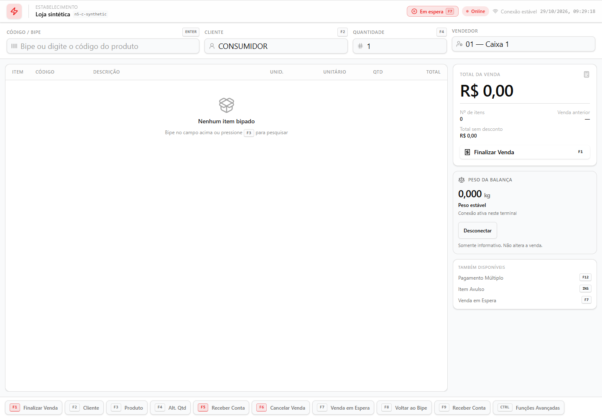
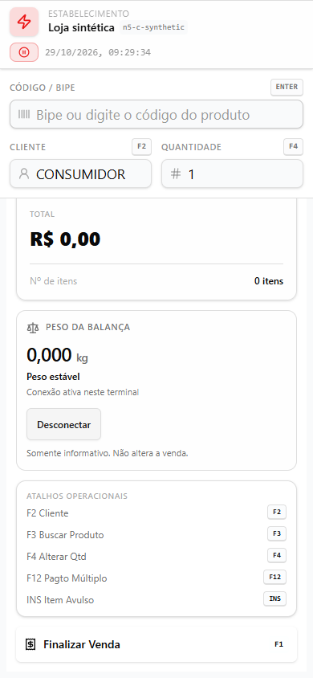

# PDV-BALANCA-VISOR-READONLY-001

Visor exclusivamente informativo no painel do total do PDV Clássico, nos modos
normal e rápido. Nenhuma leitura alimenta produto, quantidade, preço, pagamento,
estoque ou caixa. Não habilita venda por peso.

Base de preparação confirmada pela API do GitHub em 29/10/2026:
`ba010ace89e2513aac2eb4ca274d52cbaac6abb4` (`origin/main`). Antes da publicação,
a branch foi atualizada para `aaab27505a03903d9fb8333baef5b52424821093`, que
incorpora somente a PR #321 de governança AEP. Não há interseção entre os arquivos
alterados por esta entrega e a PR #315 (`104d768d7b7497fe34e2872f4253c4fd97feb5bb`).
Branch/worktree isoladas: `codex/pdv-balanca-visor-readonly-001` e
`.worktrees/pdv-balanca-visor-readonly-001`. AEP opt-in inativo; nenhuma trilha,
gate ou estado de governança foi alterado.

## Preferência e isolamento

`StoreSettings.printerConfig.pdvScaleVisorVisible` é booleano visual, fora de
`capabilities`. Booleano explícito vence o ramo; ausência usa apenas
`capabilities.business.primaryBranch === "padaria"`. Outros ramos ficam ocultos.
Não usa nome de empresa/produto, localStorage nem backfill automático da chave.

O provider só expõe a preferência após um GET válido da unidade atual. A chave
React da sessão física é a loja comprovada. Troca de loja, ocultação, saída do
PDV ou `pagehide` descartam amostras e encerram a observação anterior. Nenhuma
porta ou leitura é persistida no servidor ou compartilhada com outro terminal.

O cartão de Configurações → PDV respeita `admin.configuracoes`, inclusive para
STORE sem autoridade de plataforma. Salva um patch com **uma única chave** pela
API existente; confirma `ok`, unidade e valor retornados antes de informar
sucesso. O merge existente sob advisory lock preserva impressão, aparência,
atalhos, ramo e capabilities. Cancelar não faz requisição.

## Transporte suportado e limites

Perfil explícito **A&D HV-G/HW-G, Format 1, stream**, baseado no
[manual oficial, seções 16, 16.1 e 16.2](https://www.aandd.jp/products/manual/balances/hvw-g.pdf).
O operador precisa configurar a saída contínua em **kg** no equipamento e
escolher o perfil e a velocidade correspondentes antes de conectar. Opções
documentadas: 2400/4800/9600 baud, 7 bits, paridade par, um stop bit.

O parser exige o frame completo de largura fixa com sinal positivo, cabeçalho
`ST`/`US`, ponto decimal, unidade ` kg` e terminador CR LF. Não extrai números de
texto arbitrário, não aceita protocolos por aproximação, não autodetecta marcas
e não transmite comandos. O perfil aceita de zero até 300 kg como limite
conservador de aplicação; isso não determina a capacidade da balança.
O parser de massa do núcleo isolado existente é reutilizado. Os demais
consumidores de `hardware-bridge.ts` não mudaram.

Cada frame válido produz uma sequência e um timestamp de recebimento próprios.
`ST` comprova estabilidade pelo protocolo; `US` nunca é promovido por consultas
repetidas do mesmo buffer. Zero é leitura válida. Depois de 3000 ms sem leitura
válida, o visor remove o número e informa leitura desatualizada, mesmo que a
porta continue aberta. Frame inválido ou parcial retira o número anterior;
fragmento vencido é descartado até o próximo delimitador. Buffer limitado a 64
bytes, sem aceitar o sufixo de uma linha descartada.

Uma sessão tem um leitor por porta. A abertura depende exclusivamente de clique
do operador; não usa `getPorts` nem pede permissão automaticamente. EOF, erro de
leitura e evento de desconexão retiram a amostra. O encerramento cancela o leitor,
aguarda sua liberação, remove listeners/timer e fecha a porta. Seleção de porta
que termina depois da desmontagem não abre o dispositivo; abertura já pendente
é aguardada e fechada sem iniciar leitura.

**Toledo Prix 3 Fit permanece sem homologação.** O suporte documental ao perfil
A&D e os testes sintéticos também não constituem homologação física de A&D.

## Interface e acessibilidade

Tipografia, tokens e totalizadores existentes preservados. Peso em números
tabulares com as casas do frame recebido; estado textual acessível, controles
rotulados e alvos de toque de pelo menos 40 px. A leitura numérica não dispara
anúncios a cada frame; o estado de conexão tem região de status própria.

No desktop, total e visor ficam no painel lateral; no celular, o painel acompanha
o carrinho com rolagem vertical. A busca, tabela, atalhos e finalização continuam
acessíveis. O teste de navegador usa os componentes reais do Clássico,
OperationsProvider e CSS da aplicação, com fronteiras de I/O e serial simuladas.

## Verificação

- Unitários/componentes: **856 testes aprovados em 48 arquivos**, Node 24.19.0,
  incluindo os novos contratos, guard KG/G, servidor de venda fracionada e N5-C.
  Dois arquivos precisaram do cliente Prisma gerado localmente para importar;
  após `prisma generate`, ambos passaram. Nenhuma migration foi executada.
- Serial e preferências: `services/scale-readonly.test.ts`,
  `lib/pdv-scale-visor-settings.test.ts`, `lib/pdv-scale-visor.component.test.ts`.
- Merge concorrente: teste acrescentado a `lib/store-settings-put.test.ts`,
  exercitando o persistidor real com lock/transação em memória.
- Browser: **4/4 aprovados**, Chromium 152, normal/rápido em 1440×1000 e 390×844.
  Conexão, instável, estável, zero, expiração, desconexão e zero mutações de
  venda/quantidade/estoque/caixa; console sem erros.
- Regressão N5-C de navegador: **20/20 aprovados** nas quatro superfícies,
  incluindo pagamentos múltiplos, crédito, prazo, retry e auditoria de confirmação.
- ESLint: zero erros; dois avisos de `` preexistentes em `PdvSection.tsx`.
- `git diff --check` e `node scripts/track.mjs verify --all`: aprovados.
- TypeScript completo e reprodução automatizada dos testes: workflow
  `.github/workflows/pdv-scale-visor.yml`; status final publicado na PR.
- Build local pesado evitado por memória insuficiente. Nenhuma validação foi
  feita contra banco de produção ou dispositivo físico.

As regressões KG/G da PR #317 permanecem no Clássico, que não foi editado.
`pdv.scale.*` e `sale.fractionalQty` continuam bloqueadas. Prisma, migrations,
Fiscal, APIs/motores de venda e writers de estoque permaneceram intactos. A PR
#315 continua outra frente, sem incorporar seu schema ou migration.

Merge e deploy manual não executados. Próxima etapa: revisão humana da PR.
