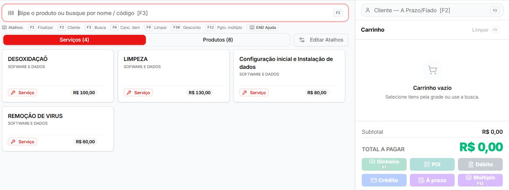
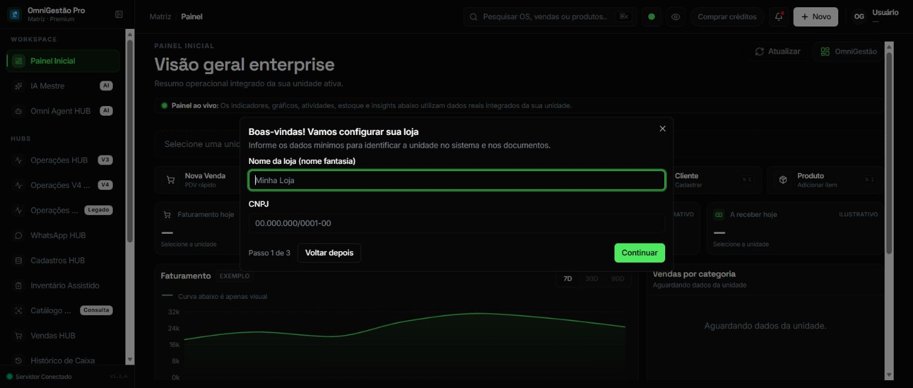

# PDV-N5-B1-PRODUCTION-SMOKE-CLOSEOUT-004 — pendência operacional

Data: 13/10/2026. Executor: Codex / `openai`.
Branch: `goal/pdv-n5b1-production-smoke-closeout-004`.
Worktree: `C:/Projetos/omni-gestao-pdv-n5b1-production-smoke-004`.

**BLOCKED no gate de sessão do legado. Nenhuma aprovação de closeout.**

[Relatório completo, matriz de oito resultados e riscos](../../pdv/PDV_N5_B1_PRODUCTION_SMOKE_CLOSEOUT_004.md).

## Evidências observadas

1. [Metadados read-only e pré-flight](PDV_N5_B1_PRODUCTION_SMOKE_CLOSEOUT_004/deployment-metadata.json):
   main `66b3044d3888b9b6ee276c4f49c380a80fd2b736`; PRs #248/#267 MERGED;
   004 único READY; 001–003 DONE; AEP open PASS; ambos os deployments Production
   READY no mesmo SHA, contendo #248 por ancestralidade Git exit 0.
2. [Observações de browser e console sanitizado](PDV_N5_B1_PRODUCTION_SMOKE_CLOSEOUT_004/browser-observations.json):
   erro Auth.js no legado às 17:08:29.886 e 17:08:30.112 UTC-03:00,
   onboarding e sessão/loja/terminal não comprovados; canônico apenas leitura
   passiva de contexto já aberto, sem revalidar sessão/cliente/terminal.
3. [Verificação documental/governança](PDV_N5_B1_PRODUCTION_SMOKE_CLOSEOUT_004/validation.txt):
   resultado do verify e das verificações locais, sem teste de negócio.
4. As capturas reais abaixo. A identidade do usuário e operador canônico foi
   excluída pelo recorte. Campos de onboarding vazios; valores visuais são
   placeholders, não cadastro efetuado. Nenhum token, cookie, senha, header de
   autenticação, dados pessoais ou valor de variável de ambiente foi registrado.

### Canônico — observação parcial, BLOCKED



A captura não prova sessão atual do servidor, versão do bundle ou terminal livre,
nem busca/interação executada. Não equivale a PASS.

### Legado — gate de sessão/loja, BLOCKED



A abertura do dashboard não comprova smoke autenticado de PDV.
Nenhum botão de onboarding foi acionado. A falha de sessão está no console
sanitizado; a imagem isolada não diagnostica sua causa.

## Vereditos

```text
MAIN_BASE=66b3044d3888b9b6ee276c4f49c380a80fd2b736
AEP_OPEN=PASS
DEPLOY_CONTAINS_PR248=YES_BOTH_METADATA_PLUS_GIT_ANCESTRY
AUTHENTICATED_SESSIONS=PRO_EXISTING_CONTEXT_ONLY;LEGACY_BLOCKED_AUTH_CONFIGURATION
SURFACES_PASS=0
SURFACES_NOT_ACCESSIBLE=0
SURFACES_BLOCKED=8
PRODUCTION_AUTHENTICATED_SMOKE=BLOCKED
SMOKE_BLOCKED=AUTH_REQUIRED
PENDING_PRODUCTION_END_TO_END=NOT_EXECUTED_BY_DESIGN
N5_B1_CLOSEOUT=BLOCKED
INDEPENDENT_R_VERDICT=NOT_EXECUTED_AUTH_GATE_BLOCKED
TECHNICAL_FILES_CHANGED=0
AEP_CLOSE=NOT_EXECUTED_AUTH_GATE_BLOCKED
VERIFY_ALL=PASS
DIFF_CHECK=PASS
COMMIT=NONE
PUSH_BRANCH=NOT_EXECUTED
PR_NUMBER=NONE
PR_URL=NONE
BLOCKERS=LEGACY_AUTH_CONFIGURATION;VALID_STORE_AND_FREE_TERMINAL_NOT_VALIDATED;CLIENT_VERSION_NOT_REVALIDATED;R_PENDING
NEXT_STEP=REGISTRAR_PENDENCIA_SMOKE_004
```

Revisão histórica R4: o corpo do PR #248 registra APPROVE por claude-code / Anthropic
informado pelo humano; reviews API vazia. Técnico `a67fedeaced289aa466196a7664f04e3faeac24b`,
close `3f4ed151660c277640d7d13ecfe90fc0cf0b52dc`,
merge `9b0a0e81f4030c1d3df2592d48021d8206f229af`.
3 arquivos/74 testes R4 e 46 arquivos/662 testes canônicos são registros históricos,
sem reexecução. Essa aprovação não substitui R do GOAL 004.

Sem venda, pagamento, abertura/fechamento de caixa, estoque, migration, alteração de
cadastros/configurações, tomada de terminal ou PENDING provocado pelo executor.
GOAL 004 permanece aberto sem DONE, sem commit, push ou PR. Não avançar N5-B2/N5-C.
