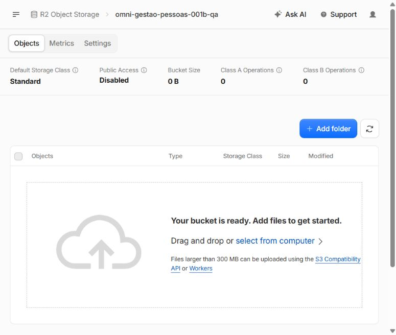
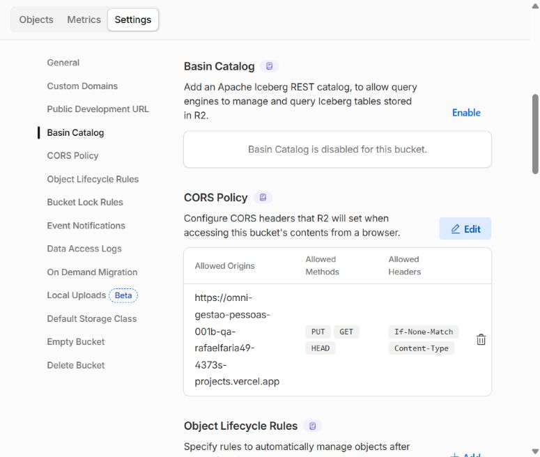
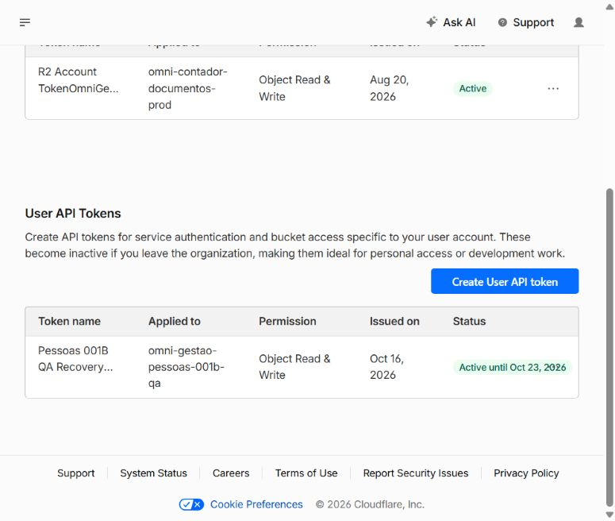
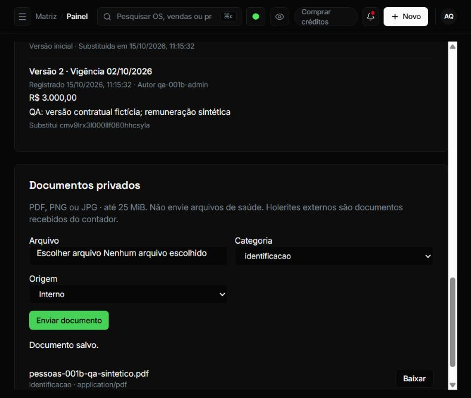
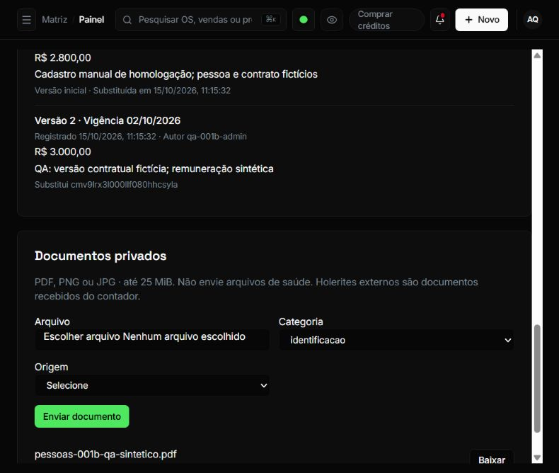
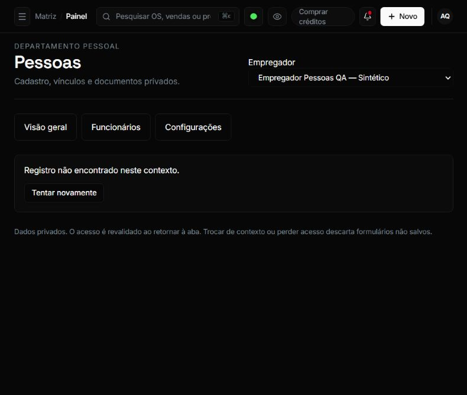

# R2 privado e Preview real — Pessoas Recovery 001B · 16/10/2026

GOAL: `PESSOAS-DP-FRONTEND-001B-RECOVERY-001`. Executor: Codex/OpenAI. Missão restrita à homologação isolada e ao registro documental; nenhum código de produto foi alterado.

## Proveniência e estado Git/AEP

O usuário confirmou o login Cloudflare no navegador do Codex e autorizou exclusivamente R2 para criar um bucket QA separado, proibindo uso/alteração do bucket produtivo, DNS e contratação paga. A autorização anterior para Neon QA, dados sintéticos e Preview privado permanece válida. A confirmação final humana autorizou Object Read & Write somente no novo bucket, uma semana de validade e armazenamento das chaves somente no Vercel QA e no cofre local criptografado. O usuário também concluiu o login Vercel normal.

- Branch/worktree: `goal/pessoas-001b-recovery-001` / `C:/Projetos/omni-gestao-pessoas-001b-recovery-001`.
- HEAD inicial local/remoto e SHA efetivamente deployado: `cdcd29f2463f98e971034932abfd6a3bc739913f`.
- Main remota consultada: `976ebaa294e09441ce0c5be7bbe5776a568f4013`. Sem rebase, merge local ou force push.
- AEP `status pessoas` e `open pessoas`: RUNNING, sessão aberta, tentativa 1/3, mesmo GOAL. Nenhum gate/derivado AEP editado; close/DONE não executado.
- [PR #273](https://github.com/rafaelfaria49-png/omni-gestao-pro-pdv-claude/pull/273) preservada como draft. O commit desta rodada transporta apenas este relatório, JSON, imagens e o relatório Recovery dentro da allowlist.
- A revisão GLM recebida do usuário continua limitada ao F-01 no SHA `6cd20313ad7f1404a99d691644c82fc92ae47a55`. Codex/OpenAI não executou revisão cross-family nem declara aprovação integral/runtime.

## Recursos QA reutilizados e novos

Neon reutilizado: projeto `orange-voice-83394974`, branch `br-twilight-shape-b5zrtyts`, banco `pessoas_001b_qa`. Baseline anterior de 109 tabelas + invariantes 0022 preservada; nenhuma reexecução de baseline, migration, seed ou concessão nesta rodada. Runtime mantém `pessoas_001b_qa_app`; a consulta de evidência explicitou o owner somente para leitura. Um vínculo por Store; o novo documento pertence somente à Store A.

Novo bucket R2: **`omni-gestao-pessoas-001b-qa`**, Standard, ENAM, **Public Access Disabled**, sem custom domain ou public development URL. O bucket `omni-contador-documentos-prod` não foi aberto, usado ou alterado; nenhuma chave produtiva foi lida/utilizada. Somente seu nome/metadados já presentes nas listagens R2 apareceram.

Token de usuário `Pessoas 001B QA Recovery 001 — 2026-10-16`: **Object Read & Write**, bucket específico QA, ativo até **23/10/2026**, sem permissão Admin. O token bearer não foi retido; somente as chaves S3 necessárias foram guardadas. Nenhum segredo, cookie ou URL assinada consta desta evidência.

CORS efetivamente salvo no bucket QA:

```json
[
  {
    "AllowedOrigins": [
      "https://omni-gestao-pessoas-001b-qa-rafaelfaria49-4373s-projects.vercel.app"
    ],
    "AllowedMethods": [
      "PUT",
      "GET",
      "HEAD"
    ],
    "AllowedHeaders": [
      "If-None-Match",
      "Content-Type"
    ],
    "ExposeHeaders": [
      "ETag"
    ],
    "MaxAgeSeconds": 300
  }
]
```

Use o alias estável abaixo para uploads: ele é a única origem liberada no CORS.

## Preview privado e configuração

[**Abrir Pessoas QA — URL de visita**](https://omni-gestao-pessoas-001b-qa-rafaelfaria49-4373s-projects.vercel.app/dashboard/pessoas)

- Projeto dedicado: `omni-gestao-pessoas-001b-qa`, ID `prj_oeXN2OJGa0fXLvkoLynD39H3hPOK`.
- Deployment: `dpl_AjM5mPXsASK6JUPwLQVWnK8smKzg`, **READY**, target API **staging/Preview**, SHA `cdcd29f2463f98e971034932abfd6a3bc739913f`.
- URL imutável da versão: `https://omni-gestao-pessoas-001b-jsp9blanb-rafaelfaria49-4373s-projects.vercel.app`. A origem CORS operacional é o alias estável.
- Proteção Vercel `all` e NextAuth normal preservados. Login Vercel humano e login de administrador sintético observados. A aba final ficou autenticada e na Store A.
- Treze variáveis criptografadas, somente Preview: `PESSOAS_DP_ENABLED`, `PESSOAS_STORAGE_PROVIDER`, `DATABASE_URL`, `DIRECT_URL`, `AUTH_SECRET`, `AUTH_TRUST_HOST`, `PESSOAS_CPF_ENC_KEY`, `PESSOAS_CPF_HMAC_KEY`, `PESSOAS_DOCUMENT_INTENT_KEY`, `R2_ACCOUNT_ID`, `R2_BUCKET`, `R2_ACCESS_KEY_ID`, `R2_SECRET_ACCESS_KEY`.
- Zero variáveis de production no projeto QA e Git link ausente. Nenhuma variável/projeto produtivo foi modificado.
- Drift específico no provedor: `No difference detected.` e `PESSOAS_QA_SCHEMA_DRIFT_ZERO`. Compilação remota concluída, tipos pulados e `MIGRATION_SKIPPED`; isso não atribui PASS a typecheck, lint ou testes.
- O commit documental posterior ao deploy não altera o produto testado; a identidade de runtime permanece fixada no SHA acima.

## Smoke documental real e seus limites

1. No frontend real, o administrador selecionou o PDF sintético de **729 bytes**, categoria `identificacao`, origem `INTERNO`; sem dados pessoais verdadeiros.
2. O botão Enviar documento executou o fluxo existente de intent, PUT e complete. A interface passou por “Calculando SHA-256…” e respondeu **“Documento salvo.”**, exibindo o arquivo e Baixar. Nenhum mock ou inserção manual em `dp_documentos`.
3. SQL somente de leitura confirmou o documento `677db717-9621-463c-9057-5b379c73e6e8`, empregador `cmv9llplm0001lf08a0i4qq9a`, vínculo `cmv9lrx2i000jlf08qokb78z8`, Store `qa-pessoas-a`, MIME `application/pdf`, classificação `COMUM`, 729 bytes e SHA abaixo. Auditoria: `DOCUMENTO_CONFIRMAR` por `qa-001b-admin` em 16/10/2026 15:22:19 UTC.
4. A lista continuou exibindo o documento após reload. O snapshot após complete positivo mostrou **Criar versão do contrato habilitado**, sem trava documental permanente.
5. O botão Baixar foi acionado e o banco registrou `DOCUMENTO_DOWNLOAD_AUTORIZAR` pelo usuário QA, inclusive às 15:46:48, 15:48:31 e 15:50:38 UTC. O backend usa nome neutro **`documento.pdf`** para o arquivo baixado.
6. **Download real confirmado pelo usuário:** após os acionamentos de Baixar, o usuário respondeu em 16/10/2026 **“Sim, o PDF foi baixado”**. Proveniência: mensagem humana neste chat; essa confirmação não é uma captura da ferramenta. A CUA sofreu timeout de foco/evento e reinicialização, sem retornar arquivo local inspecionável. O hash do arquivo recebido pelo navegador não foi conferido pela ferramenta; a integridade dos bytes do objeto QA foi conferida separadamente pelo SDK, como descrito abaixo. O nome neutro usado pelo backend é `documento.pdf`; a pergunta inicial citou o nome da listagem e a distinção foi corrigida antes da resposta. Nenhum defeito de produto é inferido do timeout da CUA.
7. Smoke específico pelo SDK existente, restrito ao objeto QA: HEAD/GET retornaram 729 bytes e hash idêntico ao original. PUT sobre o mesmo objeto com **`If-None-Match: *` recebeu HTTP 412**; GET posterior manteve o hash. Essa prova é de storage, não execução da recuperação HTTP 412 pela interface.
8. Com o documento já existente, o contexto Store B negou a URL direta do funcionário A com **“Registro não encontrado neste contexto.”**. Store A restaurada; SQL confirma um vínculo A, um B e somente um documento A.

SHA-256 do original, do registro confirmado e dos GETs QA:

```text
d658d6542efa23246c0e9a8e8d77c0519c1b61e541b74d505cb9486ddd049c64
```

O cadastro/edição/contratos e o leitor com remuneração restrita continuam documentados na [rodada de 15/10](BASELINE_PREVIEW_PRIVADO_2026-10-15.md). O login restrito não foi repetido nesta rodada. Cancelamento de Promise sem resolução, respostas tardias, expiração e recuperação pela interface, bateria R1–R5 e matriz completa permanecem pendentes.

## Segurança, custo e ocorrências

- Credenciais persistidas no cofre DPAPI CurrentUser e no Vercel QA, Preview encrypted. A revisão automática rejeitou uma tentativa de transporte em JSON plaintext antes da gravação. A alternativa utilizou RSA-OAEP-SHA256 + AES-256-GCM; a chave privada temporária ficou protegida por DPAPI. Envelope e chave de transporte foram removidos após importação. Nenhum arquivo plaintext de credencial R2 foi criado.
- Nenhum plano/serviço pago novo contratado. Neon Free, Vercel Hobby. R2 já estava habilitado e mostrou uso faturável **US$ 0,00** antes do smoke; métricas do provedor podem ter atraso.
- A [tabela oficial R2](https://developers.cloudflare.com/r2/pricing/), consultada em 16/10/2026, inclui no Standard 10 GB-mês, um milhão de operações A e dez milhões B por mês. Esta rodada usa um objeto de 729 bytes e poucas operações. A evidência não promete custo de consumos futuros/compartilhados da conta.
- Sem acesso a DNS, dados reais, bucket/chaves produtivos ou ativação de `PESSOAS_DP_ENABLED` produtivo. Sem merge, GOAL 002 ou liberação de produção.
- Os statuses GitHub existentes no SHA inicial eram success para os dois projetos Vercel e Preview Comments. Não são testes desta rodada nem aprovação do novo commit documental.

## Evidências visuais saneadas

Capturas reais; nenhuma contém CPF, segredo ou URL assinada. Valores contratuais visíveis são sintéticos, em sessão de administrador autorizada.













As 11 capturas anteriores cobrem parcialmente quatro temas e lista desktop/mobile. Estas seis novas capturas não completam a matriz visual/acessibilidade. Metadados, hashes das imagens, documento e auditoria: `QA_R2_PREVIEW_2026-10-16.json`.

## Validação e próximo gate

```text
R2_PRIVATE=CREATED_QA_ONLY_PUBLIC_ACCESS_DISABLED
TOKEN_SCOPE=OBJECT_READ_WRITE_QA_BUCKET_ONLY_EXPIRES_2026_10_23
PREVIEW=READY_PRIVATE_SHA_cdcd29f2463f98e971034932abfd6a3bc739913f
UPLOAD=REAL_POSITIVE_COMPLETE_LIST_RELOAD_CONFIRMED
STORAGE_GET_INTEGRITY=MATCH_729_BYTES
STORAGE_EXCLUSIVE_PUT=HTTP_412_OBJECT_UNCHANGED
FRONTEND_DOWNLOAD_AUTHORIZATION=AUDITED_REAL_SERVER_ACTION
FRONTEND_DOWNLOAD=CONFIRMED_BY_USER
FRONTEND_DOWNLOADED_FILE_HASH=NOT_INSPECTED_BY_TOOL
STORE_ISOLATION=STORE_B_DENIED_A_WITH_DOCUMENT_A_RESTORED
TESTS=NOT_RUN
TYPECHECK=NOT_RUN
LINT=NOT_RUN
LOCAL_BUILD=NOT_RUN
OFFICIAL_RUNNER=NOT_RUN
AUTOMATED_TESTS=PENDING
GLM_F01=APPROVE_RECEIVED_USER_ONLY
GLM_INTEGRAL=PENDING
AEP_CLOSE=NOT_RUN
PR_DRAFT=YES
NEXT_GATE=FULL_ISOLATED_VALIDATION_AND_GLM_INTEGRAL
```

Inspeção Git/allowlist e `git diff --check` são os checks locais desta missão. Sem Docker, bateria Vitest/Playwright/E2E, typecheck, lint ou build local. Ponto de parada: **PREVIEW PRIVADO REAL, UPLOAD CONFIRMADO E DOWNLOAD RELATADO PELO USUÁRIO; ACEITE INTEGRAL PENDENTE.**
