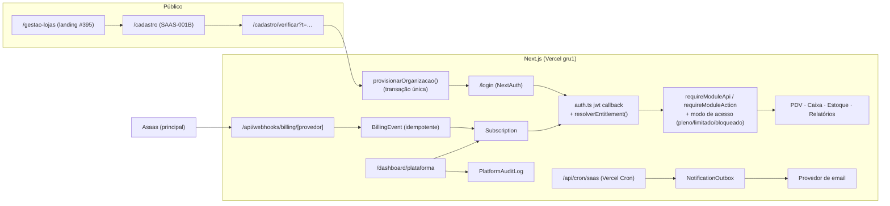
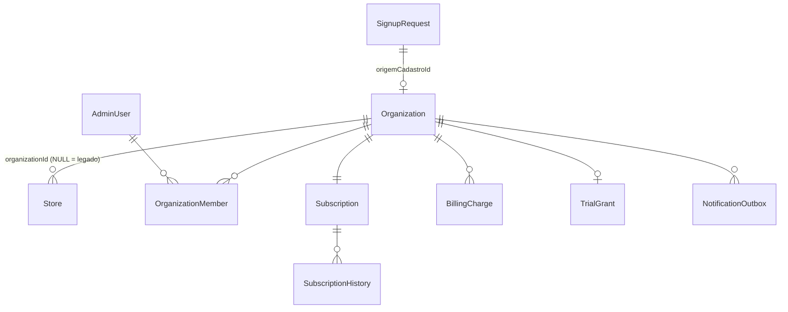
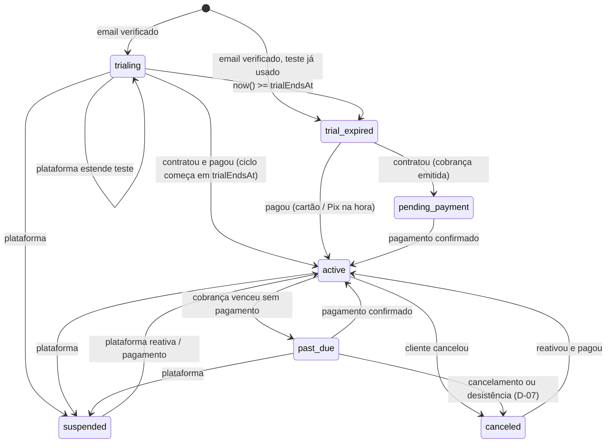

# SaaS automático — arquitetura recomendada

GOAL `OMNI-SAAS-AUTOMATICO-ARQUITETURA-ROADMAP-000` · 2026-11-23 · base `d613656`.
Estado atual e evidências: [`SAAS_AUTOMATICO_AUDITORIA_ESTADO_ATUAL.md`](SAAS_AUTOMATICO_AUDITORIA_ESTADO_ATUAL.md)
(referências `C01…C46`). Regras de negócio: [`SAAS_AUTOMATICO_REGRAS_COMERCIAIS.md`](SAAS_AUTOMATICO_REGRAS_COMERCIAIS.md).

**Estado (2026-11-24):** §3 (parte do 001A), §4 em modo sombra e §8 (infra) implementados no
SAAS-001A, PR draft, sem migration em Production — detalhes e desvios em
[`SAAS_001A_FUNDACAO_COMERCIAL.md`](SAAS_001A_FUNDACAO_COMERCIAL.md). O restante segue proposta;
cada migration exige autorização de schema.

---

## 1. Princípios

1. **Um sistema de autenticação.** Continua NextAuth v5 + `AdminUser` + `AdminSession`. O cadastro
   público cria um `AdminUser` comum; não há provedor de identidade novo.
2. **Uma fonte de verdade para o direito de uso:** a tabela `Subscription` (por organização),
   lida por **um** resolvedor (`lib/saas/entitlement.ts`). `session-entitlement.ts` (C21), o selo
   `assistec_sub_v1` (C22) e os campos Stripe do `AdminUser` (C24) deixam de ser consultados.
3. **Módulos continuam em `Store.moduleAccess`** (C17). O plano só semeia esse campo no
   provisionamento; o entitlement decide o **modo** (pleno, limitado, bloqueado), não os módulos.
4. **Lojas atuais não mudam.** `Store.organizationId = NULL` ⇒ entitlement `pleno` com origem
   `legado`, sem limite de usuários. Nenhum dado existente é reescrito.
5. **Tudo aditivo e atrás de flag.** `SAAS_CADASTRO_PUBLICO`, `SAAS_ENTITLEMENT_ENFORCE`,
   `SAAS_COBRANCA` — ausentes ou diferentes de `on` = desligado (falha fechado para o recurso novo,
   falha aberto para cliente legado).
6. **Servidor decide o tempo.** Prazos gravados como instantes absolutos; comparação com `now()`
   do banco nas transições.
7. **Receita da plataforma separada** do Financeiro/Caixa/PDV do lojista.

## 2. Visão geral



## 3. Modelo de dados proposto (migrations aditivas)

Prefixo de migration novo, uma por GOAL. Nomes em inglês para alinhar com a proposta anterior
(`SAAS_AUTOMATICO_PROPOSTA.md`) e com o vocabulário dos provedores (`trialing`, `past_due`),
que já é o usado em `AdminUser.subscriptionStatus`.



| Tabela | Campos essenciais | Regras |
|---|---|---|
| `Organization` | `id`, `nome`, `documento?` (CPF/CNPJ, opcional), `contatoEmail`, `contatoWhatsapp`, `origem` (`self_service`/`assistido`/`legado_migrado`), `origemCadastroId? @unique`, `createdAt` | `origemCadastroId` = idempotência do provisionamento |
| `OrganizationMember` | `organizationId`, `adminUserId`, `papel` (`OWNER`/`BILLING`/`MEMBER`), `@@unique([organizationId, adminUserId])` | assinatura **não** depende de membro; trocar o OWNER é só mudar `papel` |
| `Store.organizationId` | `String?` + índice | `NULL` = loja legada, comportamento inalterado |
| `Subscription` | `organizationId @unique`, `planoId`, `planoVersao`, `status`, `trialStartedAt`, `trialEndsAt`, `currentPeriodStart?`, `currentPeriodEnd?`, `graceEndsAt?`, `cancelAtPeriodEnd`, `canceledAt?`, `suspendedAt?`, `suspendedReason?`, `limitedSince?`, `precoContratadoCentavos`, `limiteUsuariosPorLoja`, `cortesiaAte?`, `provedor?`, `provedorCustomerId?`, `provedorSubscriptionId? @unique`, `version Int` | `version` = compare-and-set em toda transição |
| `SubscriptionHistory` | `subscriptionId`, `de`, `para`, `motivo`, `ator` (`sistema`/`webhook`/`plataforma:<id>`), `eventoId?`, `createdAt` | só insere; nunca altera |
| `BillingEvent` | `provedor`, `eventoId`, `tipo`, `recebidoEm`, `processadoEm?`, `resultado`, `payloadResumo` (sem dado de cartão), `@@unique([provedor, eventoId])` | idempotência e anti-replay |
| `BillingCharge` | `organizationId`, `provedorChargeId @unique`, `valorCentavos`, `metodo` (`pix`/`pix_automatico`/`cartao`/`boleto`), `status`, `venceEm`, `pagoEm?`, `estornadoEm?` | histórico de pagamentos do painel |
| `TrialGrant` | `organizationId @unique`, `emailNormalizado @unique`, `whatsappNormalizado?` (índice), `documento? @unique`, `createdAt` | um teste por pessoa/empresa |
| `SignupRequest` | `id`, `emailNormalizado`, `nome`, `nomeLoja`, `whatsapp`, `senhaHash` (bcrypt 12), `tokenHash @unique` (sha256), `expiraEm`, `usadoEm?`, `tentativasReenvio`, `consentimentoVersao`, `consentimentoEm`, `ipHash`, `status` (`pendente`/`verificado`/`provisionado`/`expirado`/`falhou`) | o token bruto só existe no email |
| `PasswordResetToken` | `adminUserId`, `tokenHash @unique`, `expiraEm` (1 h), `usadoEm?`, `ipHash` | uso único; ao usar, `sessionVersion++` |
| `NotificationOutbox` | `id`, `organizationId?`, `canal` (`email`/`interno`/`whatsapp`), `modelo`, `destino`, `dedupeKey @unique`, `agendadoPara`, `status` (`pendente`/`enviando`/`enviado`/`falhou`/`cancelado`), `tentativas`, `ultimoErro?`, `provedorMensagemId?`, `enviadoEm?` | deduplicação por chave |
| `PlatformAuditLog` | `atorId`, `acao`, `organizationId?`, `storeId?`, `antes` (JSON), `depois` (JSON), `motivo`, `ipHash`, `createdAt` | só insere; leitura restrita |

Senha do cadastro: guardada **só como hash bcrypt** em `SignupRequest` até a verificação; copiada
para `AdminUser.password` no provisionamento; o registro do cadastro é limpo (`senhaHash = ""`)
na mesma transação.

## 4. Resolvedor de entitlement (fonte única do direito de uso)

```ts
// lib/saas/entitlement.ts (proposta)
type ModoAcesso = "pleno" | "limitado" | "bloqueado"
type Entitlement = {
  modo: ModoAcesso
  origem: "legado" | "assinatura"
  motivo: "ok" | "teste" | "teste_vencido" | "carencia" | "inadimplente" | "cancelado" | "suspenso" | "cortesia"
  planoId: string | null
  limiteUsuariosPorLoja: number | null   // null = sem limite (legado)
  trialEndsAt: string | null              // ISO, para o contador
  limitedSince: string | null             // instante a partir do qual escrita nova é recusada
}
function resolverEntitlement(sub: Subscription | null, agora: Date): Entitlement  // pura e testável
```

- **Pura** (sem I/O): recebe a linha e o instante, devolve o modo. Tabela-verdade testada.
- **Integração:** o callback `jwt` de `auth.ts` (C02) já relê `AdminUser` e `Store` a cada resolução;
  passa a incluir `organization.subscription` no `findMany` de lojas e grava
  `token.storeEntitlements = { [storeId]: { modo, motivo, limitedSince } }`. Uma consulta a mais
  por resolução, no mesmo `findMany`.
- **Gates:** `requireModuleApi` recusa método diferente de `GET/HEAD` quando o modo da loja é
  `limitado`, exceto rotas da **lista de permitidas em modo limitado** (§6.3); `bloqueado` recusa
  tudo, exceto assinatura/contato/sair. `requireModuleAction` ganha parâmetro `intencao: "ler" | "escrever"`.
- **Defesa em profundidade:** as rotas críticas de escrita (venda, caixa, estoque, usuários) fazem
  uma segunda checagem lendo a assinatura no banco dentro da própria transação
  (`assertEscritaPermitida(tx, storeId, contexto)`), porque o JWT pode estar alguns segundos atrás.
- **Atrás de flag:** `SAAS_ENTITLEMENT_ENFORCE=on` liga a recusa; desligado, o resolvedor roda
  em **modo sombra** e só registra o que teria recusado (contagem por rota, sem dado pessoal).
- `session-entitlement.ts` passa a delegar ao resolvedor; `ENTITLEMENT_NAO_VERIFICADO_VENCIMENTO`
  é removido quando nenhum chamador restar.

## 5. Cadastro automático e onboarding (SAAS-001B)

### 5.1 Fluxo

```mermaid
sequenceDiagram
  autonumber
  participant U as Visitante
  participant C as /cadastro
  participant API as POST /api/saas/cadastro
  participant DB as Banco
  participant M as Email
  participant V as /cadastro/verificar
  U->>C: nome, loja, WhatsApp, email, senha ×2, aceite termos+privacidade
  C->>API: (campo-isca, captcha se D-10)
  API->>DB: limites por origem/global; SignupRequest(pendente, tokenHash, senhaHash, expira 24 h)
  API->>M: link /cadastro/verificar#t=<token> (outbox + envio imediato)
  API-->>U: "Se o email puder ser usado, enviamos um link" (resposta igual sempre)
  U->>V: abre o link
  V->>DB: transação: consome token (compare-and-set) → Organization + Store + AdminUser ADMIN + OWNER + Subscription(trialing, trialEndsAt = now()+7d) + TrialGrant + outbox(boas-vindas)
  V-->>U: "Conta criada" → /login com email preenchido
  U->>DB: login normal → assistente de 1º acesso (já existe)
```

### 5.2 Regras

| Tema | Decisão |
|---|---|
| Campos | nome do responsável, nome da loja, WhatsApp, email, senha + confirmação, aceite de termos e privacidade (versões gravadas). **Sem CNPJ e sem cartão.** Ramo é perguntado no assistente de 1º acesso (já pergunta o ramo); padrão `comercio` |
| Senha | `newPasswordSchema` (C05); confirmação só na tela; hash bcrypt já no envio |
| Token | 32 bytes aleatórios (`randomBytes`), base64url; banco guarda só `sha256`; validade 24 h; uso único por compare-and-set (`UPDATE … WHERE tokenHash = ? AND usadoEm IS NULL AND expiraEm > now()`); padrão de `lib/contador/auth-externa/convites.ts` (C09) |
| Token no link | no **fragmento** (`#t=`), lido pela página e enviado por POST — não vaza por `Referer` nem por log de acesso (mesma técnica do convite do contador) |
| Reenvio | mesmo endpoint; no máximo 3 reenvios por cadastro e 1 por minuto; cada reenvio gera token novo e invalida o anterior |
| Email já cadastrado | resposta pública idêntica; o email enviado diz "você já tem conta — entrar ou recuperar senha". Evita enumeração |
| Email com cadastro pendente | reaproveita o `SignupRequest` aberto (UNIQUE parcial em `emailNormalizado` onde `status = pendente`) e reenvia |
| Normalização | minúsculas, `trim`; para domínios Gmail remove pontos e `+sufixo` só na chave de `TrialGrant` (o email de login continua como digitado) |
| Teste repetido | `TrialGrant` com email normalizado, WhatsApp e documento: se já existe, a conta é criada **sem teste** (status `trial_expired` imediato → pode contratar). Não revela o motivo na tela pública além de "o período de teste já foi usado por este contato" depois do login |
| Antiabuso | campo-isca; corpo ≤ 8 KB; 5 cadastros/h por origem (HMAC do IP) e 30/10 min global, contados no banco (padrão C13); domínios descartáveis recusados (lista estática); captcha (D-10) |
| Provisionamento | `provisionarOrganizacao(tx, signup)` reaproveita o núcleo de `provisionClient` (C10) — extraído para aceitar `senhaHash` e `mustChangePassword: false` —, sem mudar o comportamento do provisionamento assistido |
| Idempotência | `Organization.origemCadastroId @unique` + consumo do token na mesma transação. Clique duplo / dois abas: a segunda transação não consome o token e devolve "conta já criada — entre" |
| Falha no meio | transação única: ou tudo grava, ou nada. Falha de email depois do commit não desfaz a conta (outbox reenvia). Cadastro `pendente` vencido vira `expirado` pelo cron e é apagado após 7 dias |
| Retomada | se o provisionamento falhar por erro transitório, o token **não** foi consumido; a pessoa clica de novo. Se falhar por regra (email virou usuário entre o cadastro e a verificação), status `falhou` + email explicando |
| Login automático | **não** no SAAS-001B: exigiria um segundo `Credentials` provider (mudança de auth). Redireciona para `/login` com email preenchido. Reavaliar no SAAS-006 |
| Recuperação de senha | `/recuperar-senha` → `PasswordResetToken` (1 h, uso único, sha256); resposta pública idêntica; ao trocar, `sessionVersion++` (C03) revoga todas as sessões; email de aviso "sua senha foi alterada" |
| Assistente | o existente (`components/onboarding/first-access-wizard`); acrescenta só o contador do teste e o link "contratar" |
| Credenciais | nunca senha padrão; nunca senha temporária enviada por email no self-service; nenhuma conta compartilhada entre clientes |

## 6. Ciclo de vida da assinatura

### 6.1 Estados

`Subscription.status` (valores em inglês, como `AdminUser.subscriptionStatus` e os provedores):

| Estado | Significado | Modo de acesso |
|---|---|---|
| — (`SignupRequest.pendente`) | cadastro aguardando verificação de email; não existe organização | sem acesso |
| `trialing` | teste ativo (`now() < trialEndsAt`) | pleno |
| `trial_expired` | teste acabou sem contratação | limitado |
| `pending_payment` | contratou após o teste; primeira cobrança emitida e não paga | limitado |
| `active` | pago e vigente (inclui "contratou durante o teste") | pleno |
| `past_due` | cobrança vencida; dentro da carência (`now() < graceEndsAt`) → pleno; depois → limitado | pleno → limitado |
| `canceled` | cancelado; pleno até `currentPeriodEnd`, depois limitado | pleno → limitado |
| `suspended` | ação administrativa (motivo obrigatório) | limitado ou bloqueado |

"Teste próximo do vencimento" e "renovação próxima" são **condições derivadas** (datas), não
estados. "Reativação" é **transição** (qualquer estado limitado → `active` por pagamento ou
cortesia). `cortesiaAte > now()` sobrepõe qualquer estado e dá modo pleno.



### 6.2 Tempo

- `trialEndsAt`, `currentPeriodEnd`, `graceEndsAt` são instantes `timestamptz` gravados na
  transição, calculados com `now()` **do banco** dentro da transação (uma única fonte de relógio
  para todas as instâncias serverless).
- O **acesso** é decidido por comparação na leitura (`resolverEntitlement(sub, agora)`): o teste
  vence no segundo certo mesmo se o cron atrasar. O cron só **materializa** o estado
  (`trialing → trial_expired`, com histórico) e dispara avisos.
- Datas mostradas ao cliente em `America/Sao_Paulo`.

### 6.3 Vencimento no meio de uma operação

O PDV grava vendas também offline (fila local) e o caixa fica aberto por horas. Regra determinística:

1. Ao virar limitado, grava-se `limitedSince = now()` (banco).
2. **Caixa aberto antes de `limitedSince`** (`SessaoCaixa.abertaEm < limitedSince`, status `ABERTA`)
   continua aceitando venda, recebimento, sangria, suprimento e **fechamento** até ser fechado,
   com teto de 24 h depois de `limitedSince` (PENDENTE D-09). Abrir caixa novo é recusado.
3. **Sincronização offline:** venda pendente que referencia sessão de caixa aberta antes de
   `limitedSince` é aceita mesmo depois do teto — o dinheiro já entrou na gaveta. Venda nova sem
   essa sessão é recusada com mensagem clara; **nada é apagado da fila local**.
4. A recusa acontece **antes** de qualquer mutação (mesmo padrão da porta `LOJA_NAO_RESOLVIDA` do #389).
5. Permitido sempre em modo limitado: consultar tudo, emitir relatórios/PDF, exportar,
   fechar caixa aberto, contratar/pagar, alterar a própria senha, sair, falar com o suporte.
   Proibido: criar/alterar produto, ajustar estoque, criar usuário, abrir caixa novo, venda fora da regra 2–3.
6. Aviso antes: barra `topNotice` (C37) a partir de 48 h antes, e no PDV um aviso na abertura de caixa.

## 7. Pagamentos (SAAS-003)

Escolha e justificativa: [`SAAS_AUTOMATICO_PAGAMENTOS_PROVEDORES.md`](SAAS_AUTOMATICO_PAGAMENTOS_PROVEDORES.md).

- **Adaptador por provedor** (`lib/saas/billing/asaas.ts`) atrás de uma interface pequena:
  `criarCliente`, `criarAssinatura`, `cancelarAssinatura`, `consultarCobranca`, `consultarAssinatura`.
  O resto do sistema só conhece `Subscription`/`BillingCharge`.
- Cliente do provedor = **organização** (`externalReference = organizationId`), nunca o usuário.
- **Webhook** `/api/webhooks/billing/asaas`:
  1. valida o token do cabeçalho em tempo constante (falha fechado se a env faltar);
  2. grava `BillingEvent` (`@@unique([provedor, eventoId])`) — repetição devolve 200 sem efeito;
  3. **reconsulta** a cobrança/assinatura na API do provedor (não confia no corpo do webhook);
  4. aplica a transição com compare-and-set em `Subscription.version` + `SubscriptionHistory`;
  5. responde 200 rápido; erro interno → 500 para o provedor reenviar.
- Conciliação diária (cron): lista cobranças alteradas nas últimas 48 h e corrige divergências
  (webhook perdido).
- Checkout: página própria `/dashboard/assinatura` que chama o servidor; Pix (QR + copia e cola),
  Pix Automático (autorização), cartão (link/checkout hospedado do provedor — o OmniGestão nunca
  vê número de cartão). Boleto opcional (D-02).
- As rotas Stripe legadas (C26–C28) ficam inertes para a oferta nova; remoção é GOAL separado.

## 8. Comunicação (SAAS-001A infra, SAAS-005 réguas)

- **Outbox no banco** (`NotificationOutbox`): todo envio nasce como linha com `dedupeKey`
  (ex.: `trial-d5:<organizationId>`, `verify:<signupId>:<n>`). UNIQUE impede disparo duplicado
  mesmo com cron concorrente.
- **Envio:** transacional crítico (verificação, recuperação de senha) tenta envio imediato após o
  commit; os demais saem pelo cron. Worker pega lote com `UPDATE … SET status='enviando' … RETURNING`
  (`FOR UPDATE SKIP LOCKED`), até 5 tentativas com espera crescente, depois `falhou` visível no painel.
- **Cron:** `/api/cron/saas` protegido por `CRON_SECRET` (cabeçalho `Authorization: Bearer`, padrão
  Vercel). Frequência depende do plano Vercel (D-14): Pro → a cada 15 min; Hobby → 1×/dia, aceitável
  porque o acesso não depende do cron (§6.2) e os emails críticos saem na hora.
- **Provedor de email:** Resend (principal) / Amazon SES (alternativa) — ver documento de provedores.
  Domínio próprio com SPF, DKIM e DMARC obrigatórios antes do primeiro envio real.
- **Notificação interna:** lida do entitlement (contador do teste, avisos) — não precisa de tabela.
- **WhatsApp oficial (fase posterior):** número da plataforma (não o da loja), templates aprovados
  pela Meta, opt-in gravado no cadastro (caixa separada e não marcada), opt-out por resposta.
  Reaproveita o cliente Graph de `lib/whatsapp` com credencial própria da plataforma.

## 9. Painel administrativo SaaS (SAAS-004)

Evolução de `/dashboard/plataforma` (C15), mantendo as abas atuais (Solicitações, Provisionamento):

| Área | Conteúdo |
|---|---|
| Visão geral | contagem por estado, testes que vencem em 48 h, MRR (soma de `precoContratadoCentavos` de `active`), conversão teste → assinatura (coorte por semana), cancelamentos e reativações do mês |
| Clientes | lista paginada no servidor com filtro por estado, busca por nome/email/protocolo, ordenação por vencimento |
| Detalhe | organização, lojas, usuários (contagem × limite), assinatura, histórico de estados, cobranças, notificações enviadas, uso básico (vendas nos últimos 7/30 dias, último login) |
| Ações | criar cliente manual (reusa `provisionClient`), liberar acesso (cortesia com prazo), estender teste, desconto, alterar preço contratado, suspender, reativar, reenviar email — **todas** com motivo obrigatório e `PlatformAuditLog` |
| Pendências | cadastros não verificados, provisionamentos com falha, emails com falha, divergências da conciliação |

Proteções: rotas `/api/platform/saas/*` com `requirePlatformAction`; listagens nunca devolvem
`senhaHash`, `tokenHash`, dados de cartão ou o payload bruto de webhook; detalhe busca por
`organizationId` e valida existência (sem IDOR entre clientes — a plataforma vê todos, o lojista
nunca acessa essas rotas). Uso por loja vem de agregados (`count`), não de leitura de vendas.

## 10. Clientes atuais e transição

| Grupo | Durante | Depois |
|---|---|---|
| RAFACELL `loja-1`, `loja-2` | `organizationId = NULL` → entitlement `legado/pleno`; nada muda | continuam legados; migração só se o proprietário quiser |
| Pilotos provisionados manualmente | idem | ação "vincular a organização" no painel cria `Organization` + `Subscription` com cortesia ou preço acertado em contrato, uma loja por vez, com autorização |
| Pedidos de teste assistidos (`SolicitacaoTesteComercial`) | canal continua | o provisionamento assistido passa a criar também `Organization` + `Subscription(trialing)` (SAAS-002), para entrar na mesma régua |
| Usuários com campos Stripe no `AdminUser` | nenhum efeito | campos LEGADOS, nunca lidos pelo resolvedor |

## 11. Alternativas consideradas e rejeitadas

| Alternativa | Por que não |
|---|---|
| Assinatura no `AdminUser` (estender o Stripe atual) | trocar administrador perde a assinatura; funcionário não tem relação com o pagador (C21, C24) |
| Assinatura por `Store` sem organização | rede de 2 lojas vira 2 contratos sem dono comum; cobrança e limite ficam espalhados |
| Novo provedor de identidade (Clerk, Auth0, Supabase Auth) | duplica sessões, papéis e revogação que já funcionam (C01–C04); migração de senhas; custo por usuário |
| Bloquear acesso total ao vencer | perde o caixa do dia e a confiança; viola "preservar consulta e regularização" |
| Controlar o teste só pelo provedor (trial do Stripe/Asaas) | exige cliente e muitas vezes cartão no cadastro; a regra é "sem cartão" |
| Cron como única fonte do vencimento | atraso do cron daria acesso além do prazo; Hobby roda 1×/dia |
| Fila externa (Redis/QStash/SQS) desde o início | volume inicial pequeno; outbox no Postgres basta e tem transação com o dado |
| Login automático por link mágico no SAAS-001B | exige segundo provider no NextAuth (área protegida); ganho pequeno |
| Reusar `moduleAccess` para modo limitado (tirar módulos) | módulo some da navegação e a consulta fica impossível; leitura × escrita é outra dimensão |

## 12. Decisões arquiteturais (ADR curtas)

| ID | Decisão |
|---|---|
| SAAS-ADR-01 | Entidade comercial = `Organization`; assinatura 1:1 com organização |
| SAAS-ADR-02 | Direito de uso = `resolverEntitlement` puro; JWT carrega o modo por loja; rotas críticas rechecam no banco |
| SAAS-ADR-03 | Módulos continuam em `Store.moduleAccess`; plano só semeia |
| SAAS-ADR-04 | Tempo por instante absoluto + `now()` do banco; acesso decidido na leitura |
| SAAS-ADR-05 | Webhook = autenticar + registrar evento + reconsultar provedor + compare-and-set |
| SAAS-ADR-06 | Outbox no Postgres com `dedupeKey` UNIQUE; sem fila externa na fase 1 |
| SAAS-ADR-07 | Legado (`organizationId NULL`) é sempre pleno e sem limite |
| SAAS-ADR-08 | Nada de segundo sistema de auth; recuperação de senha e verificação usam tokens próprios no padrão do convite do contador |
