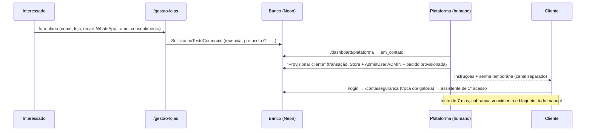

# SaaS automático — auditoria do estado atual

GOAL `OMNI-SAAS-AUTOMATICO-ARQUITETURA-ROADMAP-000` · 2026-11-23 · base `origin/main` = `d613656`
(merge da PR #395, landing premium). Somente leitura do código: nada foi executado contra banco,
Vercel ou provedores.

Ponto de entrada do programa: [`SAAS_AUTOMATICO_ROADMAP_MASTER.md`](SAAS_AUTOMATICO_ROADMAP_MASTER.md).

Legenda de classificação:

| Classe | Significado |
|---|---|
| **EXISTENTE** | funciona em produção e pode ser reaproveitado como está |
| **PARCIAL** | existe uma parte útil; precisa de extensão |
| **AUSENTE** | não há nada no código |
| **LEGADA** | existe, mas pertence a um desenho anterior; não deve receber a nova oferta |
| **INCOMPATÍVEL** | existe e contradiz a regra nova; precisa ser contido ou substituído |

> Regra desta auditoria: uma capacidade só é EXISTENTE quando há código servidor que a garante.
> Texto de interface ou documentação não conta como prova.

---

## 1. Matriz de capacidades

| # | Capacidade | Classe | Evidência no código | Reaproveitamento |
|---|---|---|---|---|
| C01 | Login email + senha | EXISTENTE | `auth.ts` (Credentials + bcrypt custo 12, `AdminUser`) | base de toda conta SaaS |
| C02 | Sessão JWT relida no servidor | EXISTENTE | `auth.ts` callback `jwt`: relê `AdminUser`, `active`, `sessionVersion` e `moduleAccess` das lojas a cada resolução | **ponto natural para o entitlement** (ver arquitetura §4) |
| C03 | Revogação de sessão | EXISTENTE | `AdminSession` + `lib/auth/admin-session.ts`; `sessionVersion` invalida todas | reset de senha e suspensão reaproveitam |
| C04 | Troca obrigatória de senha | EXISTENTE | `mustChangePassword` + `proxy.ts` (só libera `/conta/seguranca`) | não usar no self-service (o cliente define a senha) |
| C05 | Política de senha | EXISTENTE | `lib/auth/password-policy.ts` (12+ caracteres, maiúscula, minúscula, número — `app/api/admin/users/route.ts`) | mesma regra no cadastro público |
| C06 | Cadastro público de conta | **AUSENTE** | nenhuma rota cria `AdminUser` sem sessão da plataforma | SAAS-001B |
| C07 | Verificação de email | **AUSENTE** | nenhum token de email; nenhum provedor de email | SAAS-001A/001B |
| C08 | Recuperação de senha | **AUSENTE** | `SegurancaSection.tsx`: "procure o responsável pela plataforma"; reset só por administrador (`TeamPanel` `canResetPassword`) | SAAS-001B |
| C09 | Token seguro, expirável, de uso único | PARCIAL (outro domínio) | `lib/contador/auth-externa/convites.ts`: só `sha256` no banco, 72 h, estados `utilizado/revogado/expirado`, evento deduplicado | **copiar o padrão**, não o módulo |
| C10 | Provisionamento loja + ADMIN atômico | EXISTENTE | `lib/auth/provision-client.ts`: `$transaction` cria `Store` (`cliente-<uuid>`), `StoreSettings`, `AdminUser` ADMIN `accessScope: STORE`, vínculo `AdminUserStore`; gancho `aoCriar` dentro da transação | núcleo do provisionamento automático (precisa aceitar senha já definida e não gerar senha temporária) |
| C11 | Provisionamento idempotente | PARCIAL | UNIQUE de `AdminUser.email` barra conta duplicada; pedido comercial com compare-and-set (`vincularProvisionamento`) | falta chave de idempotência do próprio cadastro (`origemCadastroId`) |
| C12 | Pedido comercial de teste (assistido) | EXISTENTE | `SolicitacaoTesteComercial` (migration `20261118120000`), `lib/comercial/solicitacao-teste.ts`, `POST /api/comercial/solicitacoes-teste` | fica como **canal assistido**; o cadastro automático é fluxo novo e paralelo |
| C13 | Antiabuso no formulário público | EXISTENTE | campo-isca `site`; corpo ≤ 8 KB; 5/h por origem (HMAC do IP, IP cru nunca gravado); 60/10 min global; contagem no banco | **reaproveitar o padrão** no cadastro público |
| C14 | Consentimento versionado | EXISTENTE | `CONSENTIMENTO_VERSAO = "gestao-lojas-2026-11-18"`, gravado com data | estender a "termos + privacidade" |
| C15 | Painel da plataforma | PARCIAL | `/dashboard/plataforma` → `components/platform/SolicitacoesTeste.tsx` (pedidos) + `PilotProvisioning.tsx` (provisionar, liberar módulos por loja) | base do painel SaaS; faltam clientes, assinaturas, métricas, auditoria |
| C16 | Autoridade da plataforma | EXISTENTE (binária) | `isPlatformAuthority` / `isPlatformSession` (`lib/auth/access-policy.ts`): `accessScope = PLATFORM` ou legado `NULL` + ADMIN/SUPER_ADMIN | não há papéis finos (ver riscos R-P1-06) |
| C17 | Liberação de módulos por loja | EXISTENTE | `Store.moduleAccess` JSONB; `PATCH /api/platform/stores/[id]/access`; `resolveStoreModules`: `NULL` = legado com tudo, inválido falha fechado | **fonte única de módulos** — o plano só semeia este campo |
| C18 | Pacote básico de módulos | EXISTENTE | `BASIC_MODULE_ACCESS` = home, pdv, sales, cash, catalog, stock, reports, settings | é exatamente a oferta "Vendas e Estoque" |
| C19 | Gate server-side por módulo e loja | EXISTENTE | `requireModuleApi` / `requireModuleAction` (`lib/auth/module-access.ts`), `canUseModule`, `canAccessStore`; todos os `storeId` explícitos do pedido precisam ser autorizados | ponto central onde entra o modo "somente leitura" |
| C20 | Modo somente leitura | **AUSENTE** | os gates distinguem módulo e loja, não leitura × escrita | SAAS-002 |
| C21 | Entitlement comercial (assinatura válida) | **INCOMPATÍVEL / contido** | `lib/auth/session-entitlement.ts`: devolve sempre `status: "ativa"` e `vencimento: "9999-12-31"` ("CONTENÇÃO TEMPORÁRIA — NÃO É A ARQUITETURA FINAL"); o comentário afirma que falta Tenant/Organization | substituir pelo resolvedor de entitlement (arquitetura §4) |
| C22 | Selo de assinatura `assistec_sub_v1` | LEGADA | `lib/subscription-seal.ts`, `/api/subscription/seal` e `/verify`; o `proxy.ts` já não decide nada por ele | não reaproveitar; manter inerte até remoção autorizada |
| C23 | Empresa / organização dona das lojas | **AUSENTE** | `Store` não tem dono; não há `Organization`/`Tenant` | SAAS-001A |
| C24 | Assinatura por entidade comercial | **INCOMPATÍVEL** | assinatura vive em `AdminUser` (`stripeCustomerId`, `stripeSubscriptionId`, `subscriptionStatus`, `planName`, `currentPeriodEnd`) — trocar o ADMIN perde a assinatura | substituir por `Subscription` por organização |
| C25 | Plano por loja | LEGADA | `Store.subscriptionPlan` enum `BRONZE/PRATA/OURO`; `lib/stripe.ts` conhece também `DIAMANTE` (o enum do banco não) | não reutilizar para a oferta nova |
| C26 | Checkout Stripe | INCOMPATÍVEL | `app/api/billing/checkout/route.ts`: só Bronze–Diamante, `payment_method_types: ["card"]`, `trial_period_days: 14`, cliente por usuário | conter (não expor na oferta nova) |
| C27 | Webhook Stripe | PARCIAL | `app/api/webhooks/stripe/route.ts`: verifica assinatura (`constructEvent`), mas sem registro de `event.id` (sem idempotência) e grava no `AdminUser` | padrão de verificação aproveitável; destino errado |
| C28 | Portal de cobrança | LEGADA | `app/api/billing/portal/route.ts`, `app/dashboard/billing` | substituído pela página de assinatura nova |
| C29 | Oferta comercial no código | EXISTENTE | `lib/comercial/gestao-lojas-oferta.ts`: `precoMensalCentavos: 6990`, `usuariosInclusos: 2`, `diasTesteGratuito: 7`, `cobrancaManual: true` | fonte da oferta; migra para o catálogo de planos (`lib/saas/planos.ts`) |
| C30 | Landing pública | EXISTENTE | `app/gestao-lojas/page.tsx` (PR #395) já publica "R$ 69,90/mês", "até 2 usuários", "7 dias de teste grátis **acompanhado pela equipe**", "Nada é cobrado automaticamente sem a sua contratação" | preservar; só troca o CTA quando o cadastro público for ligado |
| C31 | Limite de usuários por loja | **AUSENTE** | busca por `maxUsuarios`/`seatLimit`/`operatorLimit`: zero; `POST /api/admin/users` e `PATCH /api/admin/users/[id]` não contam | SAAS-002 (proposta já escrita em `GESTAO_LOJAS_OPERACAO_PILOTO.md` §7) |
| C32 | Isolamento multi-loja | EXISTENTE | `storeId` em todas as consultas; E2E `access.spec.ts`, `jornada-cliente-independente.spec` (2º cliente não lê/escreve no 1º) | pré-condição atendida |
| C33 | Teste gratuito controlado pelo servidor | **AUSENTE** | `diasTesteGratuito` é texto comercial; nenhuma data de fim é gravada | SAAS-002 |
| C34 | Fonte temporal | EXISTENTE (simples) | `lib/trusted-time.ts` → `Date.now()` do servidor | usar `now()` do banco nas transições (arquitetura §6) |
| C35 | Provedor de email transacional | **AUSENTE** | nenhum pacote (`resend`, `nodemailer`, `@aws-sdk/client-ses`, `postmark`, `sendgrid`) no `package.json` | SAAS-001A |
| C36 | WhatsApp oficial | PARCIAL (outro uso) | WhatsApp Cloud API por loja (`WhatsAppPhoneNumber`, `lib/whatsapp`), feito para a loja falar com os clientes **dela** | não usar para a plataforma falar com lojistas sem número e templates próprios (SAAS-005) |
| C37 | Notificações internas | PARCIAL | slot `topNotice` do `AppShell` (barra de atualização do PWA) | aviso de teste/vencimento |
| C38 | Tarefas agendadas | **AUSENTE** | `vercel.json` → `"crons": []`; não há rota `app/api/cron*` | SAAS-001A (infra) / SAAS-005 |
| C39 | Fila de trabalhos | PARCIAL (outro domínio) | `FiscalEmissaoJob` (dormente) e fila offline do PDV (cliente) | padrão de outbox no banco, novo |
| C40 | Auditoria administrativa | PARCIAL | `recordConfigAuditFromSession` (`usuarios`), `LogsAuditoria`, `historico[]` em JSONB | falta trilha própria de ações comerciais da plataforma |
| C41 | Exportação de dados da loja | PARCIAL | relatórios e PDF por módulo; não há "exportar tudo" | SAAS-002 (acesso limitado) / backlog |
| C42 | Exclusão de dados por organização | **AUSENTE** | só procedimento manual (`PRIVACIDADE_TERMOS_PROPOSTA_PILOTO.md` §3) | backlog G-08/G-09 |
| C43 | Rate-limit distribuído genérico | PARCIAL | contagem no banco só no formulário comercial | reaproveitar o padrão (sem Redis) |
| C44 | Captcha | **AUSENTE** | nenhum Turnstile/reCAPTCHA/hCaptcha | decisão pendente D-10 |
| C45 | Feature flags | PARCIAL | env vars por recurso (`GESTAO_LOJAS_EXIBIR_PRECOS_PROPOSTOS`, `VESTUARIO_*`, `CONTADOR_LEGACY_PORTAL`) | mesmo padrão: `SAAS_*` falhando fechado |
| C46 | Créditos de IA | LEGADA (fora da oferta) | `AdminUser.creditsIA`, `User.credits`, `CreditPurchase` | não entra na oferta; não misturar com assinatura |

## 2. Superfície de escrita que o modo "somente leitura" precisará cobrir

Contagem estática em `d613656` (grep, sem execução):

| Item | Quantidade | Observação |
|---|---|---|
| `route.ts` em `app/api` | 312 | — |
| Rotas com `POST/PUT/PATCH/DELETE` | 225 | — |
| …sem `requireModuleApi`/`requirePlatformAction`/`isPlatformSession`/`requireAdmin`/`requireEnterprise` direto | 32 | usam gates próprios (`lib/aparelhos/api-gate`, `lib/catalogo-aparelhos/loja-catalogo-api`, `lib/compat/compat-api`), são públicas por desenho (webhooks, portal do contador, pedido comercial) ou são internas (`app/api/internal/fiscal/*`) |
| Arquivos de Server Actions com `requireModuleAction` | 22 de 30 em `app/actions` | os demais precisam de inventário em SAAS-002 |

Consequência: o modo somente leitura **não pode** ficar só no `requireModuleApi`. SAAS-002 começa
com um inventário gerado por script (rota × método × gate) e um teste que falha quando surge rota
de escrita sem classificação. Ver `SAAS_AUTOMATICO_SEGURANCA_E_RISCOS.md` R-P0-01.

## 3. Fluxos atuais (como o cliente entra hoje)

## 4. Infraestrutura e custo operacional (o que se sabe)

| Item | Estado | Fonte |
|---|---|---|
| Hospedagem | Vercel, projeto `omni-gestao-pro` é o único que publica Production; região de funções `gru1` | memória de release (projeto `omni-gestao` cancela builds de Production) |
| Banco | Neon (Production), `sa-east-1` | memória do cutover 004 |
| Cron Vercel | nenhum configurado | `vercel.json` |
| Plano Vercel | **não confirmado no repositório** | decisão D-14 — Hobby só permite cron 1×/dia e sem garantia de minuto |
| Email | nenhum provedor | `package.json` |
| Custos fixos (Vercel, Neon) | **sem dado no repositório**; não estimados | `LANCAMENTO_PILOTO_PAGO_001.md` §E |
| Node na Vercel | aviso de fim do Node 20 a partir de 2026-10-01 | memória de deploy |

## 5. Duplicidades e conflitos encontrados

| Conflito | Onde | Tratamento proposto |
|---|---|---|
| Três catálogos de plano: `Store.subscriptionPlan` (BRONZE/PRATA/OURO), `lib/stripe.ts` (+DIAMANTE), `lib/comercial/gestao-lojas-oferta.ts` (Vendas e Estoque) | schema + lib | um catálogo novo de planos SaaS (`lib/saas/planos.ts`); os dois primeiros ficam LEGADOS e intocados |
| Prazo de teste: 14 dias (Stripe) × 7 dias (oferta/landing) | checkout × oferta | 7 dias controlados pelo servidor; checkout legado nunca é exposto à oferta nova |
| Landing diz "acompanhado pela equipe" | `app/gestao-lojas/page.tsx` | continua verdade até o cadastro público ser ligado; trocar o texto faz parte de SAAS-006 |
| Duas noções de "assinatura": selo `assistec_sub_v1` e `AdminUser.subscriptionStatus` | lib + schema | ambas LEGADAS; o resolvedor novo lê só `Subscription` |
| `SAAS_AUTOMATICO_PROPOSTA.md` (fases S1–S7) e backlog G-01…G-10 de `LANCAMENTO_PILOTO_PAGO_001.md` | docs | consolidados no roadmap master; a proposta antiga passa a apontar para cá |

## 6. Conclusão da auditoria

O sistema já tem **identidade, isolamento, provisionamento atômico, liberação de módulos por loja
e antiabuso** confiáveis. Faltam, nesta ordem de dependência: **a entidade comercial**
(organização + assinatura), **o resolvedor de entitlement** que substitui a contenção
`session-entitlement.ts`, **o modo somente leitura** com cobertura total das escritas,
**email transacional**, e só então o **cadastro público** e a **cobrança**.
Nenhum segundo sistema de autenticação é necessário.
