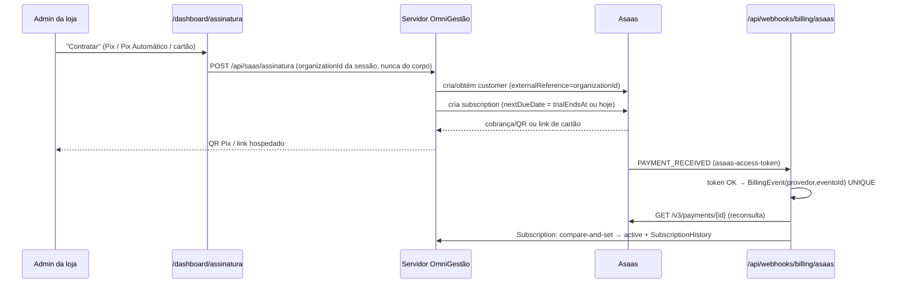

# SaaS automático — pagamentos e provedores

GOAL `OMNI-SAAS-AUTOMATICO-ARQUITETURA-ROADMAP-000` · 2026-11-23.

Pesquisa de documentação pública feita em 2026-11-23. **Nenhuma conta foi criada, nenhum
pagamento feito, nenhuma credencial configurada.** Taxas públicas variam por contrato:
todos os valores abaixo precisam ser confirmados na conta do proprietário antes de SAAS-003
(decisão D-01).

---

## 1. Modalidades — o que é cada uma

| Modalidade | Como funciona | Exige ação do cliente todo mês? |
|---|---|---|
| **Pix avulso mensal** ("assinatura com Pix") | o provedor emite uma cobrança Pix (QR/copia e cola) por mês; o cliente paga quando quiser | **sim** — é cobrança recorrente, não débito automático |
| **Pix Automático** (Banco Central, desde 16/06/2025) | o cliente autoriza **uma vez** no app do banco; as cobranças seguintes são debitadas sem nova ação, dentro do teto autorizado | não |
| **Cartão de crédito recorrente** | cartão tokenizado pelo provedor; débito no vencimento | não (salvo recusa) |
| **Boleto** | linha digitável mensal; compensação em até 3 dias úteis | sim |

Para R$ 69,90/mês o Pix Automático é o melhor equilíbrio (sem cartão, sem esquecimento), mas a
oferta via API é recente em todos os provedores — por isso o desenho mantém **Pix avulso como
caminho garantido** e cartão como alternativa.

## 2. Comparativo

| Critério | **Asaas** | Mercado Pago | Stripe |
|---|---|---|---|
| Foco | cobrança recorrente para PME brasileira | carteira/checkout de varejo | plataforma global |
| API de assinatura | `/v3/subscriptions` (Pix, boleto, cartão) | `/preapproval` e `/preapproval_plan` | Billing `subscriptions` (já usado no repositório, `stripe@22`) |
| Pix avulso recorrente | sim (assinatura `billingType = PIX`) | via checkout | Pix one-time |
| Pix Automático | sim: autorizações `/v3/pix/automatic/authorizations`; oferta automática em assinaturas criadas via API (documentada; ida a produção informada para 29/10/2026) | **não confirmado** em documentação oficial para API recebedora | changelog de 2026-04-22 anuncia assinaturas com Pix (Pix Automático via Checkout), mas a central de ajuda afirma que contas brasileiras só têm Pix avulso — **contraditório** |
| Cartão recorrente | sim | sim (assinatura autorizada) | sim, o mais maduro |
| Boleto | sim | sim | não confirmado para conta BR |
| Checkout hospedado | link de pagamento / fatura | `init_point` do checkout de assinaturas | Stripe Checkout |
| Autenticação de webhook | **token estático** no cabeçalho `asaas-access-token` (sem HMAC) | HMAC SHA-256 (`x-signature` com `ts` e `v1`) | HMAC (`Stripe-Signature`, já implementado em `app/api/webhooks/stripe`) |
| Reentrega de webhook | sim (fila por endpoint) | a cada 15 min até 200; timeout 22 s | sim, até 3 dias |
| Sandbox | sim (ambiente separado) | sim (contas de teste) | sim (modo teste) |
| Taxa Pix (pública) | R$ 1,99 por Pix recebido (promoção R$ 0,99 por 3 meses); Pix Automático sem tarifa adicional | não levantada nesta pesquisa | 1,19% "somente por convite" (fonte secundária) |
| Taxa cartão (pública) | 2,99% à vista | não levantada | ~3,99% + R$ 0,39 nacional (fonte secundária) |
| Prazo de recebimento | cartão em até 2 dias úteis; boleto em até 3 dias úteis; Pix na hora | variável por opção de liberação | cartão nacional ~30 dias (fonte secundária) |
| Exigência cadastral | conta PJ ou PF com análise de documentos | conta Mercado Pago | conta Stripe Brasil |
| Next.js / Vercel | REST simples (fetch), sem SDK obrigatório | SDK Node oficial | SDK já instalado |

Custo por mensalidade de R$ 69,90 (valores públicos, a confirmar): Pix Asaas R$ 1,99 (2,8%);
cartão Asaas ≈ R$ 2,09 (2,99%); cartão Stripe ≈ R$ 3,18 (3,99% + R$ 0,39).

Outros candidatos avaliados por alto: **Pagar.me** (API v5 com assinaturas; documentação de
webhook não confirma HMAC nativo; Pix Automático não confirmado) e **Iugu** (tem material sobre
Pix Automático). Nenhum supera o Asaas no conjunto Pix + boleto + cartão + foco em PME sem
evidência adicional; ficam como reserva.

## 3. Recomendação

**Principal: Asaas.**

1. Cobre as três modalidades relevantes (Pix, Pix Automático, cartão) e boleto numa só API.
2. Menor custo público por mensalidade e recebimento rápido.
3. Assinatura com `externalReference` = `organizationId`, separada de qualquer usuário.
4. Foco no público do produto (PME brasileira); documentação em português.

**Ponto fraco tratado na arquitetura:** o webhook é autenticado por token estático, sem assinatura
HMAC nem carimbo de tempo. Mitigação obrigatória (SAAS-ADR-05): comparar o token em tempo
constante, registrar `BillingEvent` por `id` do evento (anti-replay) e **reconsultar a cobrança na
API do Asaas** antes de mudar qualquer estado. Um webhook forjado, no máximo, provoca uma
reconsulta inofensiva. Token guardado só na Vercel (`ASAAS_WEBHOOK_TOKEN`), rotacionável.

**Alternativa: Stripe.**

- Já está no código (verificação HMAC e SDK prontos), Checkout maduro para cartão.
- Use se o Asaas recusar a conta ou se o proprietário preferir cartão como meio principal.
- Antes de depender de Pix nele, confirmar no painel da conta brasileira (documentação contraditória).
- Custo e prazo de recebimento piores para ticket de R$ 69,90.

**Mercado Pago** foi rejeitado como principal: o fluxo de assinatura depende do checkout
hospedado e não há confirmação oficial de Pix Automático via API para recebedor.

## 4. Desenho de integração (resumo — detalhe em `SAAS_AUTOMATICO_ARQUITETURA.md` §7)

Regras:

- Idempotência de criação: `idempotencyKey` próprio (`assinatura:<organizationId>:<versao>`) e
  checagem de `provedorSubscriptionId` antes de criar outra.
- Cancelamento: `cancelAtPeriodEnd = true` no OmniGestão + cancelamento no provedor; acesso pleno
  até `currentPeriodEnd`.
- Estorno/chargeback: evento do provedor → `BillingCharge.estornadoEm` + `past_due` (sem carência
  nova); a plataforma decide suspensão manualmente.
- Troca de administrador: nada muda no provedor; o `customer` é da organização.
- A mensalidade **nunca** entra no Financeiro/Caixa do lojista.

## 5. Email transacional

| Critério | **Resend** (principal) | Amazon SES (alternativa) | Brevo / outros |
|---|---|---|---|
| Plano inicial | gratuito: 3.000/mês, 100/dia; Pro US$ 20 por 50.000/mês | por envio (centavos de dólar por mil) | planos gratuitos com marca/limites |
| Integração | SDK/REST simples, feito para Next.js | SDK AWS (o repo já tem `@aws-sdk/client-s3`, mesmo ecossistema) | REST |
| Entregabilidade | domínio verificado SPF/DKIM | excelente, exige saída do sandbox SES | variável |
| Webhooks de entrega/bounce | sim | via SNS | sim |
| Observação | limite de 100/dia do gratuito exige plano pago antes da ativação comercial | mais trabalho de setup | — |

Recomendação: **Resend** no início (menor esforço, adaptador `lib/saas/email/resend.ts`), com a
interface `enviarEmail({ para, modelo, dados, dedupeKey })` permitindo trocar por SES sem mexer
nos chamadores. Transferência internacional de dados (provedor nos EUA) deve constar na política
de privacidade (suboperador).

## 6. Fontes consultadas (2026-11-23)

- Asaas — Pix Automático: <https://docs.asaas.com/docs/pix-automatico>
- Asaas — Diferença entre Pix Automático e Assinaturas: <https://docs.asaas.com/docs/diferen%C3%A7a-entre-pix-autom%C3%A1tico-e-assinaturas>
- Asaas — Oferta automática de Pix Automático em assinaturas via API: <https://docs.asaas.com/docs/oferta-automática-de-pix-automático-em-assinaturas-via-api>
- Asaas — Assinaturas (referência): <https://docs.asaas.com/reference/assinaturas-1.md>
- Asaas — Eventos de webhooks: <https://docs.asaas.com/docs/eventos-de-webhooks>
- Asaas — Eventos para Pix Automático: <https://docs.asaas.com/docs/eventos-para-pix-autom%C3%A1tico>
- Asaas — Criar webhook (token de autenticação): <https://docs.asaas.com/docs/criar-novo-webhook-pela-aplicacao-web>
- Asaas — Preços e taxas: <https://www.asaas.com/precos-e-taxas>
- Asaas — Taxas do Pix Automático: <https://central.ajuda.asaas.com/hc/pt-br/articles/41912520942235-Quais-s%C3%A3o-as-taxas-do-Pix-Autom%C3%A1tico-no-Asaas>
- Mercado Pago — Assinaturas (referência): <https://www.mercadopago.com.br/developers/pt/reference/online-payments/subscriptions/overview>
- Mercado Pago — Assinaturas com plano associado: <https://www.mercadopago.com.br/developers/pt/docs/subscriptions/integration-configuration/subscription-associated-plan>
- Mercado Pago — Notificações (x-signature): <https://www.mercadopago.com.br/developers/pt/docs/checkout-pro-orders/notifications?scope=prod>
- Stripe — Subscriptions with Pix: <https://docs.stripe.com/billing/subscriptions/pix>
- Stripe — Changelog Pix recurring (2026-04-22): <https://docs.stripe.com/changelog/dahlia/2026-04-22/pix-recurring-payments-support>
- Stripe — Pix payments: <https://docs.stripe.com/payments/pix>
- Stripe — Help: Pix no Brasil: <https://support.stripe.com/questions/how-to-enable-pix-as-a-payment-method-in-brazil>
- Banco Central — Guia Pix Automático: <https://www.bcb.gov.br/content/estabilidadefinanceira/pix/guia_pix_automatico.pdf>
- Resend — Pricing: <https://resend.com/pricing> · <https://resend.com/docs/knowledge-base/what-is-resend-pricing>
- Vercel — Cron usage and pricing: <https://vercel.com/docs/cron-jobs/usage-and-pricing>

Fontes secundárias (blogs/comparativos) só foram usadas onde marcado "fonte secundária".
