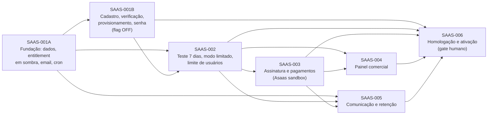

# SaaS automático — roadmap master (ponto de entrada)

GOAL de origem `OMNI-SAAS-AUTOMATICO-ARQUITETURA-ROADMAP-000` · 2026-11-23 · base `origin/main` `d613656`.

**Agente executor: comece aqui.** Leia este arquivo inteiro, depois só os documentos que o seu
GOAL citar. Confira a `main` do momento antes de agir: este roadmap descreve o estado de `d613656`.

| Documento | Para quê |
|---|---|
| [`SAAS_AUTOMATICO_AUDITORIA_ESTADO_ATUAL.md`](SAAS_AUTOMATICO_AUDITORIA_ESTADO_ATUAL.md) | o que existe no código (C01–C46), com arquivos |
| [`SAAS_AUTOMATICO_ARQUITETURA.md`](SAAS_AUTOMATICO_ARQUITETURA.md) | modelo de dados, entitlement, fluxos, estados, ADRs |
| [`SAAS_AUTOMATICO_REGRAS_COMERCIAIS.md`](SAAS_AUTOMATICO_REGRAS_COMERCIAIS.md) | oferta, teste, vencimento, retenção — APROVADA × PROPOSTA × PENDENTE |
| [`SAAS_AUTOMATICO_PAGAMENTOS_PROVEDORES.md`](SAAS_AUTOMATICO_PAGAMENTOS_PROVEDORES.md) | Asaas (principal), Stripe (alternativa), email |
| [`SAAS_AUTOMATICO_SEGURANCA_E_RISCOS.md`](SAAS_AUTOMATICO_SEGURANCA_E_RISCOS.md) | controles, P0/P1, checklist por PR |

Documentos anteriores, agora subordinados a este roadmap: `SAAS_AUTOMATICO_PROPOSTA.md` (fases
S1–S7), `LANCAMENTO_PILOTO_PAGO_001.md` §G (G-01…G-10), `GESTAO_LOJAS_OPERACAO_PILOTO.md` §7
(limite de usuários). Mapeamento na §5.

---

## 1. Regras que valem para todo GOAL do programa

1. Branch/worktree própria a partir da `origin/main` do momento; PR **draft**; sem merge e sem
   deploy de Production sem autorização explícita.
2. Schema: migration **aditiva**, prefixo novo, autorizada pelo proprietário, aplicada no banco
   antes do merge, com backup Neon (procedimento de `GESTAO_LOJAS_PROCEDIMENTO_MIGRATION.md`).
3. Auth/proxy: qualquer mudança em `auth.ts`, `auth.config.ts`, `proxy.ts` ou `lib/auth/*` exige
   autorização explícita **no texto do GOAL** (CLAUDE.md).
4. Lojas com `organizationId = NULL` nunca mudam de comportamento.
5. Tudo novo atrás de flag que, ausente, desliga.
6. Validação mínima: `npm run typecheck`, Vitest das suítes tocadas (Node 22, `--exclude ".claude/worktrees/**"`),
   `npm run build` (conferir "Compiled successfully", não só exit code), E2E da CI `platform-pilot.yml`,
   `git diff --check`.
7. Fechar com o relatório de `docs/skills/rules/DELIVERY_CHECKLIST.md` e o checklist de segurança
   (`SAAS_AUTOMATICO_SEGURANCA_E_RISCOS.md` §4).

## 2. Sequência



Ajuste em relação ao pedido original: o **SAAS-001 foi dividido em 001A e 001B**. O cadastro
precisa de `Organization`/`Subscription`/`TrialGrant`, de email e de tokens antes de existir;
juntar tudo num PR misturaria migration, área de auth e fluxo público, e o rollback ficaria
indivisível. **O cadastro público só liga em SAAS-006**, depois de 002 homologado (R-P0-02).

---

## 3. GOALs

### SAAS-001A — Fundação comercial (dados, entitlement em sombra, email, cron)

- **Estado:** implementado em PR draft (2026-11-24), migration só em PG descartável — ver
  [`SAAS_001A_FUNDACAO_COMERCIAL.md`](SAAS_001A_FUNDACAO_COMERCIAL.md) (contratos, tabela-verdade, procedimento de Production, handoff 001B).
- **Objetivo:** criar a entidade comercial e a fonte única do direito de uso, sem efeito sobre ninguém.
- **Dependências:** autorização de schema; D-11 (provedor/domínio de email) para o envio real —
  sem ela, o adaptador roda em modo "registro" (grava na outbox, não envia).
- **Escopo:**
  - migration aditiva: `Organization`, `OrganizationMember`, `Store.organizationId?`, `Subscription`,
    `SubscriptionHistory`, `TrialGrant`, `NotificationOutbox`, `PlatformAuditLog` (arquitetura §3);
  - `lib/saas/planos.ts` (catálogo; "Vendas e Estoque" lido de `OFERTA_COMERCIAL_GESTAO_LOJAS`, sem mudar valores);
  - `lib/saas/entitlement.ts` puro + tabela-verdade em Vitest;
  - integração **em sombra** no callback `jwt` (`token.storeEntitlements`) e contador de "teria recusado"
    — *exige autorização de auth*;
  - `lib/saas/email/*` (interface + Resend) e worker da outbox; `/api/cron/saas` com `CRON_SECRET`;
  - flags `SAAS_ENTITLEMENT_ENFORCE`, `SAAS_EMAIL_ENVIO` (ausentes = desligado).
- **Fora de escopo:** cadastro público, recusa de acesso, cobrança, UI do painel, mudança na landing.
- **Contratos afetados:** `prisma/schema.prisma` (aditivo), `auth.ts` (só leitura extra no `jwt`),
  `lib/auth/session-entitlement.ts` (passa a delegar; mesma forma de retorno), `vercel.json` (`crons`).
- **Critérios de aceitação:** todas as lojas atuais resolvem `legado/pleno`; tabela-verdade cobre os
  8 estados × cortesia × carência × instante exato de vencimento; outbox não envia duplicado com
  dois workers concorrentes (teste em PG descartável); cron recusa sem `CRON_SECRET`; nenhum
  comportamento observável muda com as flags desligadas.
- **Validações:** typecheck, Vitest, build, E2E piloto + RAFACELL, migration em PG descartável, `prisma migrate diff` aditivo.
- **Riscos:** R-P0-06; custo de uma junção a mais no `jwt` (medir).
- **Rollout/rollback:** migration aplicada antes do merge; flags desligadas; rollback = reverter o código (tabelas ficam vazias e sem uso).
- **Gate humano:** autorização de schema + autorização de alteração em `auth.ts`.

### SAAS-001B — Cadastro, verificação, provisionamento e recuperação de senha

- **Objetivo:** fluxo landing → cadastro → email → loja + ADMIN + teste → login, funcionando em Preview.
- **Dependências:** 001A; D-10 (captcha), D-11, D-15 (termos/privacidade com versão), D-16 (aviso fiscal).
- **Escopo:** migration aditiva `SignupRequest`, `PasswordResetToken`, `Organization.origemCadastroId`;
  `/cadastro`, `/cadastro/verificar`, `/recuperar-senha`, `/redefinir-senha`; `POST /api/saas/cadastro`,
  `.../reenviar`, `.../verificar`, `POST /api/auth/senha/esqueci` e `.../redefinir`;
  `provisionarOrganizacao()` extraído de `provisionClient` (assistido sem mudança); limpeza de cadastros
  vencidos no cron; flag `SAAS_CADASTRO_PUBLICO` que só aceita `on` quando `SAAS_ENTITLEMENT_ENFORCE=on`.
- **Fora de escopo:** trocar CTA da landing; login automático; cobrança; recusa de acesso.
- **Contratos afetados:** `lib/auth/provision-client.ts` (extração), `proxy-session-gate.ts` (rotas públicas novas) — *auth*.
- **Critérios de aceitação:** token só em hash, 24 h, uso único, no fragmento; respostas públicas
  idênticas para email novo/existente/pendente; duplo clique na verificação = uma organização;
  falha no meio = nada gravado; teste repetido (email normalizado/WhatsApp) cria conta sem teste;
  reset revoga sessões; limites por origem/global funcionam entre instâncias (contagem no banco);
  nenhuma senha temporária no self-service; provisionamento assistido inalterado (E2E existente verde).
- **Validações:** typecheck, Vitest, build, E2E novo `cadastro-self-service.spec` em PG descartável
  (com email capturado pelo adaptador de teste), E2E piloto existente.
- **Riscos:** R-P0-02, R-P1-01, R-P1-05, R-P1-08.
- **Rollout/rollback:** flag OFF em Production; Preview com sandbox de email; rollback = flag OFF.
- **Gate humano:** autorização de schema + auth; aprovação do texto de termos/privacidade.

### SAAS-002 — Teste gratuito, modo limitado e limite de usuários

- **Objetivo:** 7 dias reais controlados pelo servidor e acesso limitado sem perder dados nem caixa.
- **Dependências:** 001A (e 001B para o caminho self-service; o assistido já serve para testar).
- **Escopo:** inventário de escritas por script + teste de cobertura (R-P0-01); modo `limitado`/`bloqueado`
  em `requireModuleApi`, `requireModuleAction` (intenção ler/escrever) e gates de domínio;
  `assertEscritaPermitida(tx, …)` em venda, caixa, estoque, usuários; regra `limitedSince` + caixa aberto
  (arquitetura §6.3); contador do teste e avisos no `topNotice`; materialização de estados no cron;
  `assertVagaUsuario` com advisory lock (segurança §1.1); provisionamento assistido passa a criar
  `Organization` + `Subscription(trialing)`; ligar `SAAS_ENTITLEMENT_ENFORCE` só após modo sombra limpo.
- **Fora de escopo:** pagamento (contratar mostra "fale com a equipe" até 003), painel completo.
- **Contratos afetados:** gates de `lib/auth/*` (*auth*), rotas de venda/caixa/estoque (*core PDV* — autorização explícita), `app/api/admin/users*`.
- **Critérios de aceitação:** zero rota de escrita sem classificação; com relógio controlado: dia 6
  pleno, `trialEndsAt` + 1 s limitado; venda em caixa aberto antes do vencimento conclui e fecha;
  abrir caixa novo recusado com mensagem; venda offline de sessão anterior sincroniza; consulta,
  relatório, PDF e exportação funcionam em limitado; 2 usuários no limite, 3º recusado, criação
  simultânea → um só; loja legada sem mudança; nada apagado.
- **Validações:** typecheck, Vitest, build, E2E com relógio (PG descartável), E2E PDV/Caixa existentes,
  regressão RAFACELL; revisão independente (Codex/Opus) antes de ligar enforcement.
- **Riscos:** R-P0-01, R-P0-03, R-P0-06, R-P1-03.
- **Rollout/rollback:** 1) sombra em Production por ≥ 7 dias com contagem de recusas virtuais; 2) enforce
  só para organizações `self_service`; 3) assistidos. Rollback = `SAAS_ENTITLEMENT_ENFORCE` off.
- **Gate humano:** autorização para tocar gates/auth e PDV/Caixa; aprovação para ligar enforcement; D-04, D-05, D-09.

### SAAS-003 — Contratação, pagamentos e renovação

- **Objetivo:** cliente contrata, paga (Pix, Pix Automático, cartão), renova, cancela e reativa sozinho.
- **Dependências:** 002; D-01 (conta Asaas criada **pelo proprietário**, chaves sandbox), D-02, D-06, D-07, D-13.
- **Escopo:** migration aditiva `BillingEvent`, `BillingCharge`; adaptador Asaas; `/dashboard/assinatura`;
  `POST /api/saas/assinatura` (contratar/cancelar/reativar) restrito a ADMIN com papel OWNER/BILLING;
  webhook `/api/webhooks/billing/asaas` (SAAS-ADR-05); conciliação diária; contenção das rotas Stripe
  legadas para a oferta nova (R-P1-07); flag `SAAS_COBRANCA`.
- **Fora de escopo:** notas fiscais da mensalidade; múltiplos planos; add-ons; split.
- **Contratos afetados:** novas tabelas; nenhuma tabela do Financeiro/Caixa/PDV (R-P0-05).
- **Critérios de aceitação:** webhook sem token → 401; evento repetido → sem efeito; evento forjado com
  token vazado → reconsulta não confirma, nada muda; contratar no dia 3 mantém acesso e 1º vencimento =
  `trialEndsAt`; Pix pago → `active` em < 1 min; cartão recusado → `past_due` com carência; cancelar →
  pleno até `currentPeriodEnd`; trocar ADMIN não afeta assinatura; nenhuma escrita em tabelas do lojista.
- **Validações:** typecheck, Vitest, build, testes de contrato com payloads do sandbox, E2E com webhook simulado, sandbox Asaas real em Preview.
- **Riscos:** R-P0-04, R-P0-05, R-P1-04.
- **Rollout/rollback:** sandbox em Preview → produção com `SAAS_COBRANCA` só para organizações de teste do proprietário → geral. Rollback = flag off (assinaturas existentes continuam no provedor; cancelamento manual se preciso).
- **Gate humano:** criação da conta e chaves pelo proprietário; aprovação antes da 1ª cobrança real.

### SAAS-004 — Painel administrativo comercial

- **Objetivo:** gestão centralizada de clientes, testes, assinantes, pagamentos, métricas e ações auditadas.
- **Dependências:** 002 (estados), 003 (cobranças), D-12 (papéis de plataforma).
- **Escopo:** arquitetura §9; `/api/platform/saas/*`; ações com motivo + `PlatformAuditLog`;
  vincular pilotos existentes a organização; excluir caminhos do runtime caching do PWA.
- **Fora de escopo:** redesign visual das abas existentes; BI avançado.
- **Contratos afetados:** `components/platform/*`, `app/dashboard/plataforma/page.tsx`.
- **Critérios de aceitação:** lojista recebe 403 em toda rota do painel; nenhuma resposta contém `senhaHash`,
  `tokenHash` ou payload bruto; cada ação grava auditoria com antes/depois; MRR e conversão batem com
  consulta SQL de conferência; paginação e busca no servidor.
- **Validações:** typecheck, Vitest, build, E2E plataforma × lojista, conferência SQL (role RO).
- **Riscos:** R-P1-06, R-P1-08.
- **Rollout/rollback:** aba nova dentro do painel existente; rollback = ocultar aba.
- **Gate humano:** D-12.

### SAAS-005 — Comunicação e retenção

- **Objetivo:** réguas automáticas por email e aviso interno; preparar WhatsApp oficial.
- **Dependências:** 001A (outbox), 002 (estados), 003 (eventos de pagamento), D-11.
- **Escopo:** modelos: verificação, boas-vindas, primeiros passos (D1), dicas (D3), teste vence em 2 dias (D5),
  teste venceu (D7), convite para contratar (D10), pagamento confirmado, renovação em 5 dias, pagamento
  pendente, carência acabando, cancelamento, reativação; `dedupeKey` por evento; descadastro de emails
  não transacionais; histórico de notificações por cliente.
- **Fora de escopo:** WhatsApp em produção (só desenho e opt-in gravado); campanhas de marketing.
- **Critérios de aceitação:** cada modelo dispara uma vez por chave mesmo com cron repetido; falha de envio
  reprocessa até 5 vezes e aparece no painel; transacionais saem mesmo com descadastro de marketing.
- **Validações:** Vitest da régua com relógio, teste de concorrência da outbox, envio real para caixas de teste.
- **Riscos:** R-P1-01, R-P1-02, R-P1-11.
- **Rollout/rollback:** `SAAS_EMAIL_ENVIO` por modelo; rollback = desligar modelo.
- **Gate humano:** aprovação dos textos; WhatsApp: número da plataforma e templates aprovados pela Meta (D-17).

### SAAS-006 — Homologação e ativação comercial

- **Objetivo:** provar o ciclo inteiro e ligar o cadastro público com segurança.
- **Dependências:** 001A–005 mergeados e homologados.
- **Escopo:** auditoria integrada (segurança §4 em todo o programa); E2E ponta a ponta: cadastro → teste →
  venda → vencimento → limitado → contratação → pagamento sandbox → pleno → cancelamento → reativação;
  regressão RAFACELL/pilotos; teste de carga leve no cadastro; observabilidade e alertas;
  trocar CTA e textos da landing ("acompanhado pela equipe" → cadastro automático) atrás da flag;
  `/privacy` e termos publicados; rollout gradual.
- **Critérios de aceitação:** zero P0 aberto; todos os P1 com mitigação ou aceite escrito do proprietário;
  roteiro executado pelo proprietário em Production com email próprio.
- **Rollout:** 1) flag ligada só com parâmetro de convite; 2) aberto com teto diário de cadastros;
  3) aberto. **Rollback:** `SAAS_CADASTRO_PUBLICO` off — contas criadas continuam funcionando.
- **Gate humano:** **obrigatório** — aprovação explícita do proprietário para ligar cada etapa.

## 4. Matriz GOAL × área protegida

| GOAL | Schema | Auth/proxy | Core PDV/Caixa | Landing | Pagamento real |
|---|---|---|---|---|---|
| 001A | sim | sim (leitura no `jwt`) | não | não | não |
| 001B | sim | sim (rotas públicas, extração do provisionamento) | não | não | não |
| 002 | não (salvo `limitedSince` já em 001A) | sim (gates) | **sim** | não | não |
| 003 | sim | não | não | não | sandbox → real com aprovação |
| 004 | não | não | não | não | não |
| 005 | não | não | não | não | não |
| 006 | não | não | não | **sim** | sim (aprovado) |

## 5. Reconciliação com o backlog anterior

| Anterior | Onde ficou |
|---|---|
| S1 / G-01 `Organization` + `Store.organizationId` | SAAS-001A |
| S2 / G-02 limite de usuários | SAAS-002 |
| S3 / G-03 `Subscription` + `BillingEvent` | `Subscription` em 001A; `BillingEvent` em 003 |
| S4 / G-04 teste controlado + só leitura | SAAS-002 |
| S5 / G-05 cadastro self-service | SAAS-001B (ativação em 006) |
| S6 / G-06 inadimplência | SAAS-003 (estados) + 005 (avisos) |
| G-07 registro de pilotos (`PilotoComercial`) | substituído por "vincular a organização" (SAAS-004) |
| S7 / G-08 / G-09 exportação e exclusão | backlog pós-006 (depende de D-08) |
| G-10 expurgo de pedidos descartados | backlog pós-006 (depende de D-08) |
| Proposta antiga: "restrição a partir da próxima abertura de caixa" | mantida e detalhada (arquitetura §6.3) |
| Proposta antiga: estado `trial` | renomeado `trialing` (vocabulário dos provedores e de `AdminUser.subscriptionStatus`) |

## 6. Decisões pendentes do proprietário

| ID | Decisão | Recomendação | Bloqueia |
|---|---|---|---|
| D-01 | Provedor de pagamento e criação da conta (pelo proprietário) | Asaas; Stripe como alternativa | 003 |
| D-02 | Oferecer boleto | não no início (Pix + cartão bastam) | 003 |
| D-03 | Preço é por loja; rede com N lojas paga N × R$ 69,90? | sim, por loja | 003 |
| D-04 | O ADMIN conta entre os 2 usuários | sim | 002 |
| D-05 | Teto de extensão de teste sem aprovação extra | 30 dias no total | 002 / 004 |
| D-06 | Antecedência da cobrança Pix avulsa | 5 dias | 003 |
| D-07 | Carência após vencimento e quando `past_due` vira cancelamento | 3 dias de carência; nunca cancelar sozinho, só limitar | 003 |
| D-08 | Prazos de retenção e exclusão | ver regras §6 (validar com contador/advogado) | backlog |
| D-09 | Teto do caixa aberto após o vencimento | 24 h | 002 |
| D-10 | Captcha no cadastro | Cloudflare Turnstile (gratuito, sem rastreio publicitário) | 001B |
| D-11 | Provedor de email e domínio remetente | Resend + subdomínio próprio com SPF/DKIM/DMARC | 001A (envio real) |
| D-12 | Papéis da plataforma (quem pode estender, descontar, suspender) | `PLATFORM_ADMIN` (tudo) e `PLATFORM_SUPORTE` (ler, reenviar email, estender ≤ 7 dias) | 004 |
| D-13 | Contratar durante o teste não perde os dias | aprovar | 003 |
| D-14 | Plano Vercel (Hobby ou Pro) | Pro antes da ativação (cron a cada 15 min) | 005 / 006 |
| D-15 | Termos de uso, política de privacidade, razão social/CNPJ do operador | texto jurídico revisado | 001B / 006 |
| D-16 | Aviso fiscal no cadastro (sem NFC-e) e público-alvo | aviso explícito + aceite | 001B |
| D-17 | WhatsApp oficial da plataforma (número, templates, opt-in) | depois da ativação por email | 005 (parte WhatsApp) |

## 7. Próximo GOAL recomendado

Não iniciar sem aprovação. Texto sugerido:

```text
GOAL=OMNI-SAAS-001A-FUNDACAO-COMERCIAL
AUTORIZAÇÃO: schema aditivo (Organization, OrganizationMember, Store.organizationId, Subscription,
SubscriptionHistory, TrialGrant, NotificationOutbox, PlatformAuditLog) e leitura adicional no
callback jwt de auth.ts, sem recusar acesso. Migration aplicada em PG descartável; aplicação em
Production só com autorização separada.
LER: docs/comercial/SAAS_AUTOMATICO_ROADMAP_MASTER.md §3 SAAS-001A e os documentos citados.
ENTREGAR: catálogo de planos, resolverEntitlement puro com tabela-verdade, entitlement em modo
sombra, adaptador de email + outbox + /api/cron/saas, flags desligadas por padrão.
NÃO FAZER: cadastro público, recusa de acesso, cobrança, mudança na landing, merge, deploy.
VALIDAR: typecheck, Vitest, build, E2E piloto e RAFACELL, git diff --check.
ENTREGA: PR draft + relatório DELIVERY_CHECKLIST.
```
